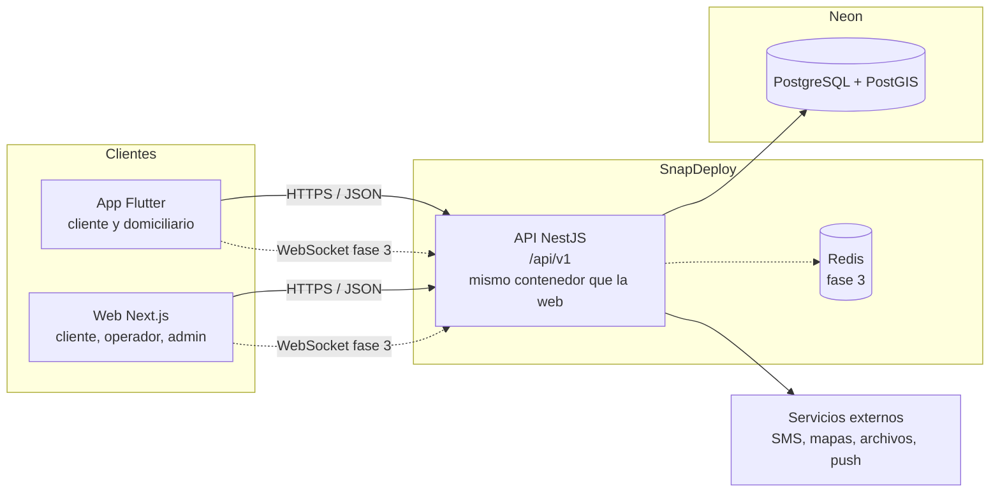
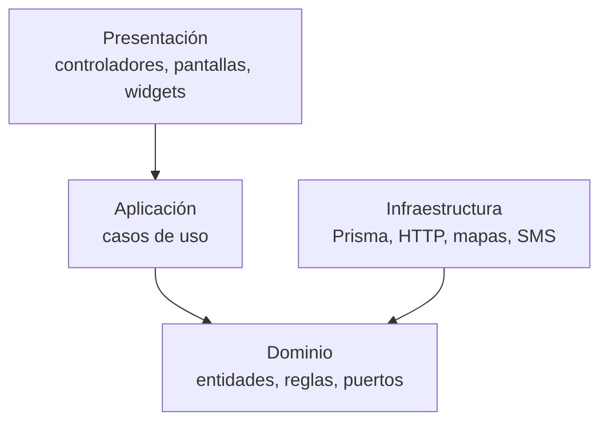

# 03 · Arquitectura

## Vista general



Un solo backend sirve a todos los clientes. La web y la app nunca hablan con la base de datos ni entre sí.

## Monorepo

```
RapiChonta/
├── api/          # Backend NestJS
├── web/          # Next.js
├── app/          # Flutter
├── Docs/         # Esta documentación
├── Dockerfile    # Contenedor único (API + web) para SnapDeploy
├── start.sh      # Arranque de ese contenedor
└── render.yaml   # Entorno de pruebas en Render
```

Cada carpeta es un proyecto independiente con sus propias dependencias. En pruebas, el `Dockerfile` de la raíz construye la API y la web en un solo contenedor: la web atiende el puerto público y reenvía `/api/*` a la API interna ([guía](08-despliegue-render.md)). `api/` y `web/` conservan su propio `Dockerfile` para desplegarlos por separado cuando haga falta escalar.

## Arquitectura limpia

Los tres proyectos siguen la misma idea: **el negocio en el centro, los detalles técnicos afuera, y las dependencias apuntan hacia adentro.**



- **Dominio:** entidades (`Order`, `Establishment`), value objects (`GeoPoint`) y puertos (interfaces de repositorio). No conoce frameworks. Aquí vive, por ejemplo, la máquina de estados del pedido.
- **Aplicación:** casos de uso (`FindNearbyEstablishments`, `CreateOrder`, `AssignCourier`). Orquestan el dominio a través de los puertos.
- **Infraestructura:** implementaciones concretas de los puertos (Prisma/PostGIS, cliente HTTP, proveedor de SMS).
- **Presentación:** cómo entra y sale la información (controladores REST, pantallas, widgets).

Beneficio práctico: cambiar Prisma por otro ORM, OpenStreetMap por Google, o efectivo por una pasarela de pagos solo toca infraestructura.

### API (`api/src`)

Organizada por **módulos de negocio**, cada uno con sus cuatro capas:

| Módulo | Responsabilidad | Fase |
| --- | --- | --- |
| `health` | Estado del servicio | 0 ✅ |
| `establishments` | Establecimientos, área del local y búsqueda geográfica | 0 ✅ / 1 |
| `catalog` | Menús: productos, precios, tiempos de preparación | 1 |
| `identity` | Registro, OTP, sesiones, roles, modo cliente del domiciliario | 1 |
| `orders` | Creación, estados, ajustes por producto faltante, incidencias | 1 (dominio ✅) |
| `dispatch` | Disponibilidad, ofertas al domiciliario, geocercas | 2 |
| `cash` | Cajas diarias, movimientos, cierre de cuentas | 2 |
| `fees` | Zonas con tarifa fija (barrios y veredas) | 1 |
| `settings` | Horario de operación, comisión, topes y tiempos límite, tasa de cambio | 1 |
| `notifications` | Push (FCM y Huawei Push Kit), SMS | 2 |

Si un módulo necesita escalar por separado (por ejemplo `dispatch`), se extrae como servicio aparte sin tocar los demás, porque ya está aislado.

Convenciones de la API: prefijo `/api`, versión en la URL (`/v1`), validación estricta de entrada (rechaza campos desconocidos), errores de negocio como `422` y errores de validación como `400`.

### Web (`web/src`)

`app/` (rutas) → `presentation/` (vistas, componentes, hooks) → `core/application` (casos de uso) → `core/domain`. La infraestructura (`infrastructure/http`, `repositories`) implementa los puertos y `infrastructure/di/container.ts` los conecta. Los componentes nunca llaman `fetch` directamente.

Rutas previstas: `/` (mapa), `/pedido/[id]` (seguimiento), `/operador` (panel de despacho), `/admin` (catálogo y domiciliarios).

### App (`app/lib`)

*Feature-first*: cada funcionalidad (`establishments`, `orders`, `auth`, `courier`) tiene `domain/`, `data/` y `presentation/`. Riverpod hace de contenedor de dependencias. El mismo binario sirve para cliente y domiciliario: la navegación cambia según el rol del usuario autenticado.

## Idiomas

Los textos nunca se escriben en el código:

- **Web:** `web/messages/es.json` y `en.json`, cargados con next-intl. El idioma sale de la elección del usuario (cookie), si no del navegador, si no español. Plurales y formatos de número con ICU (`{count, plural, ...}`).
- **App:** `app/lib/l10n/app_es.arb` y `app_en.arb` (JSON); Flutter genera la clase `AppLocalizations` con un método por texto, así un texto faltante es un error de compilación y no un texto vacío en pantalla.
- **API:** responde **códigos** (`NEARBY_FAILED`, `ORDER_LIMIT_EXCEEDED`), no frases; cada cliente los traduce. Los textos que salen del servidor (notificaciones push, SMS) usan sus propios archivos `api/src/i18n/<idioma>.json` y el idioma guardado del usuario (`User.locale`).

Agregar un idioma es copiar el archivo español y traducirlo. Si más adelante se quiere que personas no técnicas editen los textos, estos mismos archivos se pueden sincronizar con una plataforma de traducción (Crowdin, Tolgee) sin cambiar el código.

## Tiempo real

- **Notificaciones push** (fase 2): oferta al domiciliario, cambios de estado al cliente, aviso de tiempo de preparación cumplido, decisión por producto faltante, "tu pedido está llegando".
- **Ubicación del domiciliario → API** (fase 2): la app la envía cada pocos segundos mientras tiene un pedido activo; la API evalúa las geocercas. No se reenvía al cliente.
- **Estado en pantalla** (fase 2): las pantallas abiertas consultan el estado cada pocos segundos, suficiente con 2 domiciliarios. En la fase 3 se cambia a WebSocket (Socket.IO + Redis) cuando el volumen lo pida.
