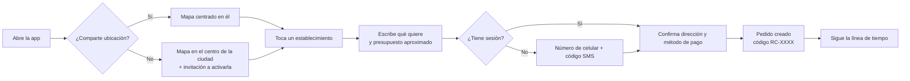
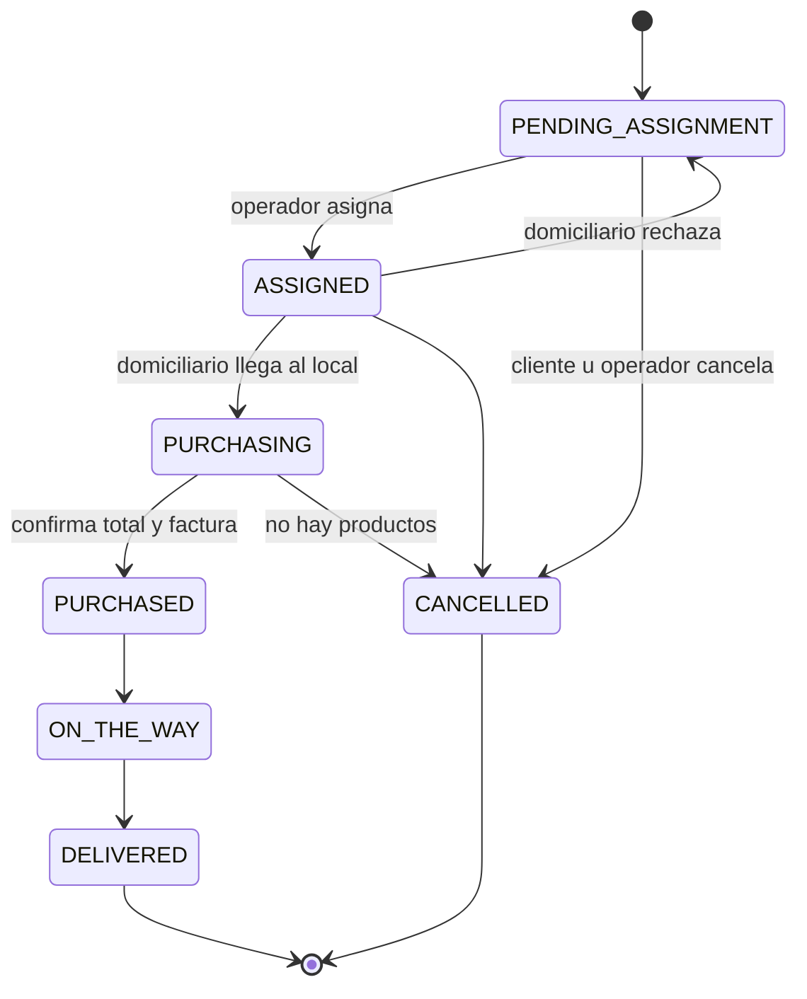

# 05 · Flujos y experiencia de usuario

## Principios

1. **Un pedido en tres toques:** elegir lugar en el mapa → escribir lo que quiero → confirmar dirección y pago. Nada de formularios largos.
2. **Sin ambigüedad:** cada pantalla tiene una sola acción principal (botón amarillo grande). El cliente siempre sabe en qué estado está su pedido, quién lo lleva y cuánto va a pagar.
3. **El mapa es la casa:** la pantalla principal no es una lista, es el mapa de su zona. Es lo que diferencia a RapiChonta de las apps de catálogo.
4. **Movimiento con propósito:** las animaciones explican qué pasó (la tarjeta del lugar sube desde el marcador, la línea de tiempo del pedido avanza), no decoran.
5. **Bilingüe desde el día uno:** español e inglés, detectado por el idioma del teléfono y cambiable en "Mi cuenta".
6. **Accesible:** contraste AA, botones de mínimo 48 px, textos que escalan con la configuración del sistema.

## Pantalla principal

```
┌──────────────┬─────────────────────────────────────────┐
│ RapiChonta   │          (Cerca de ti · 12 lugares)     │
│              │                                         │
│ EXPLORAR     │      📍        🍔                       │
│ ▣ Comida     │              🔵 tú                      │
│   rápida     │   🍕                  🛒                │
│ ▣ Restau-    │                                         │
│   rantes     │        ┌───────────────────────┐        │
│ □ Super-     │        │ Burger Demo · 450 m   │        │
│   mercados   │        │ [     Pedir aquí     ]│        │
│ □ Tiendas    │        └───────────────────────┘        │
│ □ Farmacias  │                                         │
│──────────────│                                         │
│ Mis pedidos  │                                     [+] │
│ Mi cuenta    │                                     [-] │
└──────────────┴─────────────────────────────────────────┘
```

- **Web y tableta:** menú fijo a la izquierda (se colapsa a íconos en pantallas medianas), mapa en el resto.
- **Teléfono:** el mismo menú como panel deslizable (drawer) para no quitarle espacio al mapa.
- Las categorías del menú funcionan como filtros del mapa (se pueden combinar).
- Al tocar un marcador sube la tarjeta del establecimiento con distancia y el botón "Pedir aquí".

## Flujo del cliente



La sesión se pide **solo al confirmar**, no al abrir la app: el usuario explora sin fricción.

## Flujo del operador (asignación manual)

1. El pedido entra a la cola del panel `/operador` con alerta sonora y se ordena por antigüedad.
2. Al abrirlo, el panel muestra en el mapa el establecimiento, la dirección del cliente y los domiciliarios disponibles con su distancia al establecimiento (el más cercano primero).
3. El operador elige uno y asigna. El domiciliario recibe la notificación.
4. Si el domiciliario no acepta en el tiempo definido (propuesta: 60 s), el pedido vuelve a la cola marcado como "reasignar".

Esta pantalla está diseñada para que, más adelante, el paso 3 lo haga un algoritmo sin cambiar el resto.

## Flujo del domiciliario

Disponible → recibe asignación → acepta → "Comprando" → registra total y foto de la factura → "En camino" → "Entregado" (cobra al cliente).

Si un producto no está, el domiciliario escribe al cliente desde el pedido (fase 2: chat dentro del pedido; en el MVP, botón que abre WhatsApp con el número enmascarado o el del operador).

## Estados del pedido



La máquina de estados ya está implementada y probada en `api/src/modules/orders/domain/entities/order-status.ts`. Después de `PURCHASED` el pedido no se puede cancelar porque el dinero ya se gastó.

## Sistema visual

| Token | Valor | Uso |
| --- | --- | --- |
| `brand` | `#FFC531` | Acción principal, elementos activos |
| `brand-strong` | `#E08A00` | Textos de acento sobre fondo claro |
| `ink` | `#14121F` | Menú lateral, textos, marcadores |
| `surface` | `#F4F2EE` | Fondo general |

Tipografía: Plus Jakarta Sans (web). Bordes redondeados generosos (16–24 px), sombras suaves, marcadores con forma de gota en color `ink` con la inicial del lugar. Los mismos tokens están en `web/src/app/globals.css` y `app/lib/app/theme.dart`.

**Ideas para diferenciar la experiencia** (a validar en diseño):
- Línea de tiempo del pedido con el recorrido animado y la foto de la factura visible para el cliente (transparencia total del dinero).
- Modo oscuro del mapa por la noche, automático.
- "Repetir pedido" en un toque desde "Mis pedidos".
- Marcadores que muestran el tiempo estimado de entrega en lugar de solo la distancia.
