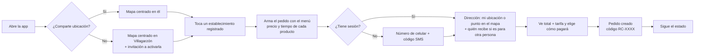
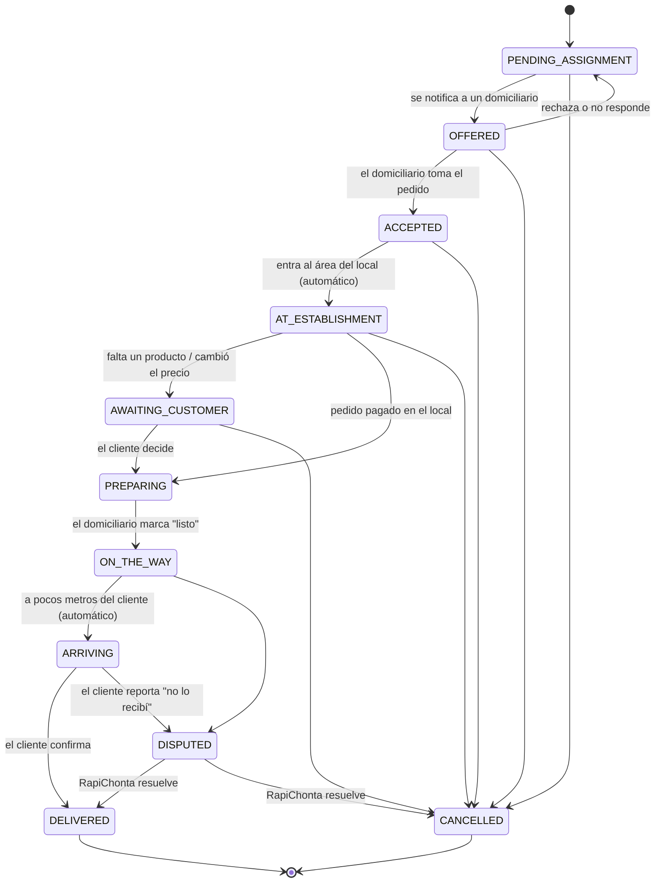

# 05 · Flujos y experiencia de usuario

## Principios

1. **Pedir en pocos toques:** elegir lugar en el mapa → agregar productos del menú → confirmar dirección y pago. Nada de formularios largos.
2. **Sin ambigüedad:** cada pantalla tiene una sola acción principal (botón amarillo grande). El cliente siempre sabe en qué estado está su pedido y cuánto va a pagar, y cada decisión que se le pide tiene opciones cerradas.
3. **El mapa es la casa:** la pantalla principal no es una lista, es el mapa de su zona. Es lo que diferencia a RapiChonta de las apps de catálogo.
4. **Movimiento con propósito:** las animaciones explican qué pasó (la tarjeta del lugar sube desde el marcador, la línea de tiempo del pedido avanza), no decoran.
5. **Bilingüe desde el día uno:** español e inglés, detectado por el idioma del teléfono y cambiable en "Mi cuenta".
6. **Accesible:** contraste AA, botones de mínimo 48 px, textos que escalan con la configuración del sistema.

## Pantalla principal

```
┌──────────────┬─────────────────────────────────────────┐
│ RapiChonta   │          (Cerca de ti · 12 lugares)     │
│              │                                         │
│ EXPLORAR     │      📍        🍔                       │
│ ▣ Comida     │              🔵 tú                      │
│   rápida     │   🍕                  🛒                │
│ ▣ Restau-    │                                         │
│   rantes     │        ┌───────────────────────┐        │
│ □ Super-     │        │ Burger Demo · 450 m   │        │
│   mercados   │        │ [     Pedir aquí     ]│        │
│ □ Tiendas    │        └───────────────────────┘        │
│ □ Farmacias  │                                         │
│──────────────│                                         │
│ Mis pedidos  │                                     [+] │
│ Mi cuenta    │                                     [-] │
└──────────────┴─────────────────────────────────────────┘
```

- **Web y tableta:** menú fijo a la izquierda (se colapsa a íconos en pantallas medianas), mapa en el resto.
- **Teléfono:** el mismo menú como panel deslizable (drawer) para no quitarle espacio al mapa.
- Las categorías del menú funcionan como filtros del mapa (se pueden combinar).
- Al tocar un marcador sube la tarjeta del establecimiento con distancia y el botón "Pedir aquí".

## Flujo del cliente



- La sesión se pide **solo al confirmar**, no al abrir la app.
- Solo se puede pedir en establecimientos registrados; no existe "pedir en otro lugar".
- La dirección puede ser la ubicación actual o un punto elegido en el mapa, con referencia ("casa azul, segundo piso"). Si el pedido es para otra persona, se registra su nombre y teléfono.
- El total se calcula con los precios del menú más la tarifa del domicilio configurada por el administrador.

## Asignación: el domiciliario acepta el pedido

1. Al crearse el pedido, se notifica (push) a un domiciliario disponible y verificado, empezando por el más cercano al establecimiento.
2. La notificación abre una pantalla con el establecimiento, los productos, el total a comprar y la tarifa, y dos botones: **Tomar pedido** / **No puedo**.
3. Si acepta, el cliente recibe "Tu pedido está en proceso".
4. Si rechaza o no responde en el tiempo definido (propuesta: 60 s), se ofrece al siguiente. Si nadie acepta, el pedido aparece resaltado en el panel del operador para que gestione.
5. Cada oferta, aceptación y rechazo queda registrada (trazabilidad).

## Estados que ve el cliente

El cliente **no ve la ubicación del domiciliario**, solo una línea de tiempo con el estado:

| Estado | Lo que ve el cliente | Quién lo cambia |
| --- | --- | --- |
| `PENDING_ASSIGNMENT` / `OFFERED` | Buscando domiciliario | Sistema |
| `ACCEPTED` | Tu pedido está en proceso, el domiciliario va al establecimiento | Domiciliario (acepta) |
| `AT_ESTABLISHMENT` | El domiciliario está en el establecimiento haciendo tu pedido | **Automático:** la app detecta que entró al área del local |
| `AWAITING_CUSTOMER` | Necesitamos tu decisión sobre un producto | Domiciliario (reporta) |
| `PREPARING` | Tu pedido se está preparando (con cuenta regresiva) | Domiciliario (pagó en el local) |
| `PREPARING` + retraso | El local tiene mucha demanda, tu pedido sigue en preparación | Domiciliario (responde al aviso) |
| `ON_THE_WAY` | Tu pedido va en camino | Domiciliario (marca "listo") |
| `ARRIVING` | Tu pedido está llegando | **Automático:** distancia domiciliario–cliente bajo el umbral |
| `DELIVERED` | Entregado | **Cliente** ("Recibí mi pedido") |
| `DISPUTED` | Reportaste un problema; RapiChonta lo está revisando | Cliente ("No lo recibí") |



La máquina de estados está implementada y probada en `api/src/modules/orders/domain/entities/order-status.ts`. Desde `PREPARING` el pedido ya no se puede cancelar porque el dinero ya se gastó; cualquier problema posterior se maneja como incidencia.

## Detección automática por ubicación (geocercas)

- **Área del establecimiento:** al registrar un local, el administrador dibuja en el mapa un polígono que cubre el local y su entrada (columna `area`). No basta un punto porque el GPS tiene error de 10 a 30 m.
- Mientras el pedido está en `ACCEPTED`, la app del domiciliario envía su ubicación cada pocos segundos; la API comprueba con PostGIS si está dentro del área (`ST_Covers`) y, tras dos lecturas seguidas dentro, pasa el pedido a `AT_ESTABLISHMENT`.
- En `ON_THE_WAY`, cuando la distancia al punto de entrega baja del umbral (propuesta: 80 m), el pedido pasa a `ARRIVING` y el cliente recibe la notificación.
- La ubicación del domiciliario solo se guarda mientras tiene un pedido activo o está disponible, y **nunca se envía al cliente**.

## Tiempo de preparación

- Cada producto del menú tiene un tiempo estimado; el del pedido es el del producto que más tarda.
- Al pasar a `PREPARING` se calcula la hora estimada (`estimatedReadyAt`) y el cliente ve una cuenta regresiva.
- Al cumplirse, el domiciliario recibe un aviso con dos botones: **Ya está listo** (pasa a `ON_THE_WAY`) o **Sigue en preparación** (se marca el retraso, el cliente ve el mensaje de alta demanda y el aviso se repite en unos minutos).

## Producto no disponible o con otro precio: chat estratégico

No es un chat libre. El domiciliario elige el producto con problema y el motivo; el cliente recibe una notificación y una pantalla con **opciones cerradas**:

- **Cambiar por:** lista de productos del mismo establecimiento (sugeridos primero los de la misma categoría y precio parecido).
- **Quitar el producto** y seguir con el resto.
- **Aceptar el nuevo precio** (si el motivo es cambio de precio).
- **Cancelar el pedido.**

La decisión tiene un tiempo límite visible (propuesta: 3 minutos) porque el domiciliario está esperando. Si vence, se aplica la opción por defecto (propuesta: quitar el producto; si era el único, cancelar). Cada decisión queda registrada en `OrderAdjustment`.

## Entrega y confirmación

1. Al llegar el pedido a `ARRIVING`, el cliente recibe una notificación y, si tiene la app abierta, se muestra una **pantalla de entrega** con el total a pagar y el botón **Recibí mi pedido**.
2. Esa pantalla no se puede cerrar hasta que el cliente marque **Recibí mi pedido** o **No lo recibí**.
3. El cliente paga al domiciliario: efectivo, o Nequi, Daviplata o transferencia escaneando el QR que el domiciliario le muestra.
4. **No lo recibí:** se crea una incidencia, el pedido pasa a `DISPUTED`, el operador recibe una alerta prioritaria y el domiciliario es notificado. El operador decide (entregado o cancelado) y ambos reciben la resolución.

## Flujo del domiciliario

Activa "Disponible" → recibe notificación → **Tomar pedido** → va al local (la app detecta la llegada) → compra o reporta un problema → paga en el local y registra el total → espera la preparación (responde los avisos) → **Ya está listo** → va al cliente → muestra el QR o recibe efectivo → el cliente confirma.

El domiciliario puede cambiar a **modo cliente** desde su menú para hacer pedidos propios. Esa opción solo existe para usuarios con rol domiciliario; los clientes nunca ven la opción de ser domiciliario.

## Panel del operador

- Lista de pedidos activos con su estado y alertas: sin domiciliario, preparación retrasada, decisión del cliente vencida, incidencias.
- Detalle de cada pedido con su línea de tiempo completa (quién hizo qué y cuándo).
- Acciones: ofrecer el pedido a un domiciliario específico, cancelar, resolver incidencias.

## Sistema visual

| Token | Valor | Uso |
| --- | --- | --- |
| `brand` | `#FFC531` | Acción principal, elementos activos |
| `brand-strong` | `#E08A00` | Textos de acento sobre fondo claro |
| `ink` | `#14121F` | Menú lateral, textos, marcadores |
| `surface` | `#F4F2EE` | Fondo general |

Tipografía: Plus Jakarta Sans (web). Bordes redondeados generosos (16–24 px), sombras suaves, marcadores con forma de gota en color `ink` con la inicial del lugar. Los mismos tokens están en `web/src/app/globals.css` y `app/lib/app/theme.dart`.

**Ideas para diferenciar la experiencia** (a validar en diseño):
- Línea de tiempo del pedido animada, con la cuenta regresiva de preparación y la foto de la factura visible para el cliente (transparencia total del dinero).
- Modo oscuro del mapa por la noche, automático.
- "Repetir pedido" en un toque desde "Mis pedidos".
- Marcadores que muestran el tiempo de preparación típico del local en lugar de solo la distancia.
