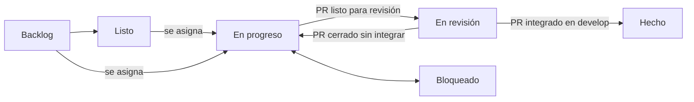

# 12 · Flujo de trabajo, backlog y seguimiento

El trabajo de RapiChonta se organiza en **épicas** e **historias de usuario** que viven como issues de GitHub. GitHub Actions las mueve de estado según lo que pasa con los issues y los pull requests, y mantiene a la vista el avance del proyecto. Las épicas, historias y requerimientos iniciales salen de esta documentación y están en [13 · Requerimientos y backlog](13-requerimientos.md).

## Tipos de issue

| Tipo | Qué es | Ejemplo |
| --- | --- | --- |
| **Épica** | Una capacidad grande del producto, ligada a una fase del [roadmap](07-roadmap.md). Agrupa historias como sub-issues. | E04 · Pedido del cliente |
| **Historia** | Algo que una persona necesita poder hacer, con criterios de aceptación y los requerimientos que cubre. Es la unidad que se asigna. | H04.3 · Confirmar el pedido |
| **Tarea** | Trabajo técnico sin valor visible directo (configuración, refactor). Puede colgar de una historia o épica. | Migrar a Prisma 7 |
| **Bug** | Algo que no funciona como debería. | El mapa no carga en Huawei |

Cada issue lleva etiquetas de **tipo**, **estado**, **fase** (1 a 5), **área** (`api`, `web`, `app`, `docs`, `infra`) y **prioridad** (alta, media, baja). Están definidas en [`.github/labels.yml`](../.github/labels.yml).

## Estados

Un issue tiene un solo estado a la vez. Casi todos los cambios son automáticos:

| Estado | Significa | Cómo llega ahí |
| --- | --- | --- |
| `estado: backlog` | Identificado, sin refinar | Al crearse |
| `estado: listo` | Refinado, con criterios claros; se puede tomar | A mano, o al quitar todos los asignados de algo en progreso |
| `estado: en progreso` | Alguien lo está trabajando | Al asignarlo, o al abrir un PR en borrador que lo cierra |
| `estado: en revisión` | Tiene un PR listo para revisar | Al abrir el PR (no borrador) o marcarlo listo para revisión |
| `estado: bloqueado` | No puede avanzar | A mano, con un comentario que diga por qué |
| `estado: hecho` | Integrado en `develop` | Al integrar el PR, o al cerrar el issue como completado |

Poner a mano una etiqueta de estado quita la anterior. Una épica pasa a **en progreso** cuando empieza su primera historia y se **cierra sola** cuando se cierra la última.

## Ciclo de una historia

1. **Elegir** una historia en estado *listo* (o *backlog* si ya está clara) y asignarla. Pasa a *en progreso*.
2. **Rama** desde `develop`: `feature/<número>-<tema>`, por ejemplo `feature/34-carrito`. El número al inicio de la rama también enlaza el PR con el issue.
3. **PR a `develop`** con `Closes #34` en la descripción (la plantilla ya lo trae). En borrador, el issue sigue *en progreso*; listo para revisión, pasa a *en revisión*.
4. **Integrar**: al hacer merge, el flujo cierra el issue con un comentario, lo marca *hecho* y actualiza el progreso. GitHub solo cierra issues por sí mismo cuando el PR entra a la rama por defecto; el flujo lo hace también para `develop`.

## Definición de listo y de terminado

**Lista para tomar** cuando: tiene rol, objetivo y beneficio claros; criterios de aceptación comprobables; requerimientos citados; área, fase y prioridad puestas; y no depende de algo sin hacer (si depende, se dice en el issue).

**Terminada** cuando: se cumplen todos los criterios; los casos de uso nuevos tienen pruebas unitarias y el dominio se prueba sin base de datos; los textos visibles están en español e inglés; `Docs/` está al día si cambió una decisión; y el PR está integrado en `develop` con el CI en verde. Cada historia trae esta lista al final.

## Ver el progreso

- **Issue fijado "📊 Progreso del proyecto"**: avance total, por fase y por épica, lo que está en revisión, en progreso, bloqueado y listo para tomar, y los bugs abiertos. Se reescribe con cada cambio y todos los días a las 6:00 a. m.
- **Cada épica** muestra la barra de avance de sus sub-issues y la lista de sus historias.
- **Tablero de GitHub Projects "RapiChonta · Tablero"**: columnas Backlog, Listo, En progreso, En revisión, Bloqueado y Hecho, con campos Fase, Prioridad y Tipo para filtrar o agrupar (también se puede agrupar por *Parent issue* para ver cada épica). Lo crea y sincroniza el flujo cuando existe el secreto `PROJECT_TOKEN`.

## Asignar trabajo a los agentes Claude

Los agentes de Claude del proyecto RapiChonta trabajan sobre estos issues:

1. En el chat del proyecto, pida por número o por id: *"toma la historia #34"*, *"trabaja H04.3"* o *"toma las historias listas de la épica E01"*.
2. El agente pone la etiqueta `agente: claude` y mueve el issue a *en progreso*, lee la historia, sus requerimientos y los documentos enlazados, implementa en una rama, y abre un PR a `develop` con `Closes #34`.
3. El flujo mueve el issue a *en revisión*. Usted revisa e integra; el issue pasa a *hecho*.

El issue de progreso muestra qué tiene cada agente en la lista *En progreso*. Si el agente encuentra un bloqueo, pone `estado: bloqueado` y explica en un comentario qué necesita.

## Agregar trabajo

- **Desde GitHub**: *New issue* → Historia de usuario, Tarea técnica, Bug o Épica. Al guardarla, el flujo le pone las etiquetas de área, fase y prioridad y la enlaza como sub-issue de la épica o historia indicada.
- **Desde el repositorio**: agregue la épica o historia (con un id nuevo) en [`backlog/epicas.yml`](../backlog/epicas.yml) y los requerimientos nuevos en [`backlog/requerimientos.yml`](../backlog/requerimientos.yml), regenere este catálogo con `node .github/scripts/cli.js docs` y abra un PR. Al integrarse en `develop`, el flujo *Backlog* crea solo lo que falta.

Un issue creado por el flujo no se vuelve a escribir desde el YAML: después de creado, el issue es la fuente de verdad y se edita en GitHub.

## Configuración (una sola vez)

1. **Rama por defecto `develop`** (recomendado). *Settings → General → Default branch*. GitHub toma de la rama por defecto las plantillas de issue y los flujos que reaccionan a issues; mientras sea `main`, esas piezas solo funcionan cuando lleguen a `main`. Con `develop`, además, `Closes #N` cierra el issue sin ayuda.
2. **Token del tablero**. GitHub no deja que el token de Actions escriba en proyectos de un usuario, así que el tablero necesita uno propio:
   - En GitHub: *Settings (de su perfil) → Developer settings → Personal access tokens → Tokens (classic) → Generate new token*, con los permisos `project` y `repo`.
   - En el repositorio: *Settings → Secrets and variables → Actions → New repository secret*, nombre `PROJECT_TOKEN`.
   - Ejecute *Actions → Backlog → Run workflow* (o espere al siguiente cambio). El tablero se crea con el nombre "RapiChonta · Tablero". Para usar un tablero que ya existe, cree la variable `PROJECT_NUMBER` con su número.
   - En el tablero, cambie la vista a *Board* agrupada por *Status*.
3. **Proteger `main` y `develop`** con PR obligatorio y checks requeridos (historia H05.3).

## Piezas del flujo

| Archivo | Qué hace |
| --- | --- |
| [`backlog/epicas.yml`](../backlog/epicas.yml), [`backlog/requerimientos.yml`](../backlog/requerimientos.yml) | Semilla del backlog y catálogo de requerimientos |
| [`.github/labels.yml`](../.github/labels.yml) | Etiquetas del repositorio |
| [`.github/workflows/backlog.yml`](../.github/workflows/backlog.yml) | Crea etiquetas, épicas e historias; reescribe el progreso; sincroniza el tablero. Corre al cambiar el backlog en `develop`, a diario y a mano |
| [`.github/workflows/flujo.yml`](../.github/workflows/flujo.yml) | Mueve estados con cada evento de issues y PR |
| [`.github/workflows/validar-backlog.yml`](../.github/workflows/validar-backlog.yml) | En los PR, valida el backlog, que este catálogo esté al día y prueba los scripts |
| [`.github/scripts/`](../.github/scripts) | Lógica de los flujos (Node), con pruebas en `test/` |
| [`.github/ISSUE_TEMPLATE/`](../.github/ISSUE_TEMPLATE), [`.github/pull_request_template.md`](../.github/pull_request_template.md) | Plantillas de issue y PR |
