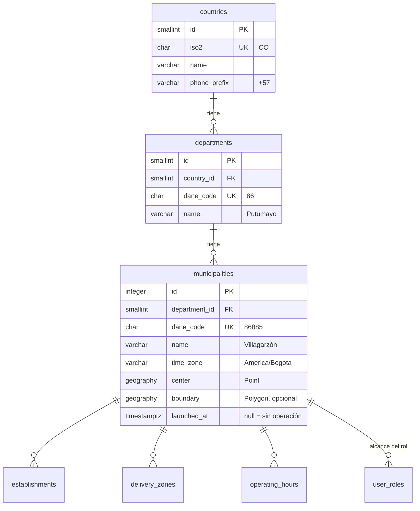
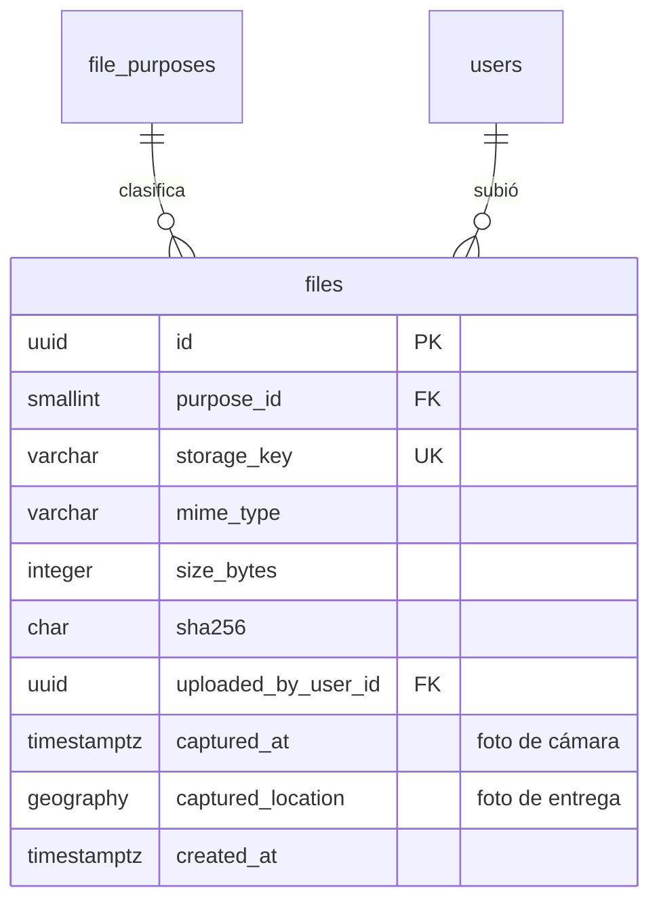

# 00 · Transversal

Tablas que usan todas las épicas: el molde de los catálogos, la geografía (para operar en varios municipios), idiomas, monedas, archivos y auditoría. Se crean en la primera migración de E01.

## Molde de los catálogos

Todas las tablas catálogo tienen al menos estas columnas:

| Columna | Tipo | Nulo | Regla |
| --- | --- | --- | --- |
| `id` | `smallint` identity | no | PK |
| `code` | `varchar(40)` | no | `UNIQUE`, `SCREAMING_SNAKE_CASE`, nunca cambia |
| `sort_order` | `smallint` | no | Orden en listas y líneas de tiempo |
| `deactivated_at` | `timestamptz` | sí | Un código dado de baja no se puede usar en filas nuevas |

Hay dos clases:

- **Catálogos del sistema**: el código del programa depende de sus `code` (estados, roles, medios de pago). Solo cambian por la semilla en un PR. Sus textos están en los archivos de idioma de la web y la app (`order_status.ACCEPTED`).
- **Catálogos del negocio**: los administra el administrador desde el panel (categorías de establecimiento, bancos). Sus nombres visibles van en una tabla `<catálogo>_translations (<catálogo>_id, language_id, name)` con PK compuesta. Un catálogo del sistema cuyos textos se muestran en el panel y el administrador quiere poder redactar (motivos de cancelación) también puede tener su tabla `*_translations`.

## Geografía

| Tabla | Columna | Tipo | Nulo | Regla |
| --- | --- | --- | --- | --- |
| `countries` | `iso2` | `char(2)` | no | `UNIQUE` |
| | `name` | `varchar(80)` | no | |
| `departments` | `country_id` | FK `countries` | no | |
| | `dane_code` | `char(2)` | no | `UNIQUE` (código DANE) |
| | `name` | `varchar(80)` | no | `UNIQUE (country_id, name)` |
| `municipalities` | `department_id` | FK `departments` | no | |
| | `dane_code` | `char(5)` | no | `UNIQUE` |
| | `name` | `varchar(80)` | no | |
| | `time_zone` | `varchar(40)` | no | IANA; define la fecha de negocio y el horario |
| | `center` | `geography(Point)` | no | Centro del mapa cuando el usuario no comparte ubicación |
| | `boundary` | `geography(Polygon)` | sí | Límite del municipio (para saber a qué municipio pertenece un punto) |
| | `launched_at` | `timestamptz` | sí | `NULL` = aún no opera (H15.4) |

- **Por qué:** RF-98 (otros municipios del Putumayo). El municipio de una dirección **no se guarda**: un pedido siempre usa el municipio de su establecimiento, y la dirección debe caer en una zona de ese municipio. `boundary` es opcional y solo sirve para mapas y reportes.
- Semilla: Colombia → Putumayo → Villagarzón (`launched_at` = fecha del piloto).

## Idiomas y monedas

| Tabla | Columnas | Semilla |
| --- | --- | --- |
| `languages` | `id`, `code` (`es`, `en`; BCP 47), `sort_order`, `deactivated_at` | `es`, `en` |
| `currencies` | `id`, `code` (`COP`, `USD`, `EUR`; ISO 4217), `minor_units smallint`, `sort_order` | `COP` (0 decimales visibles), `USD`, `EUR` |

La moneda de cobro es siempre COP (RNF-05); `USD` y `EUR` existen para el precio aproximado (H03.4, [E03](E03-zonas-horario-configuracion.md#tasas-de-cambio-h034-rf-17)).

## Medios de pago

`payment_methods` (sistema). Lo usan las cuentas de cobro del domiciliario ([E01](E01-identidad-y-acceso.md)), el medio elegido en el pedido ([E04](E04-pedido-del-cliente.md)) y los movimientos de caja ([E11](E11-cajas-y-comisiones.md)).

| code | is_cash_on_delivery | is_account_based | requires_bank | Fase |
| --- | --- | --- | --- | --- |
| `CASH` | sí | no | no | MVP |
| `NEQUI` | sí | sí | no | MVP |
| `DAVIPLATA` | sí | sí | no | MVP |
| `BANK_TRANSFER` | sí | sí | sí | MVP |
| `PSE` | no | sí | no | E14 (`deactivated_at` lleno hasta entonces) |
| `CARD` | no | sí | no | E14 (`deactivated_at` lleno hasta entonces) |

Qué medios se pueden pagar en línea y por qué pasarela lo dice `payment_gateway_methods` en [E14](E13-E15-fases-futuras.md#h141-pago-en-línea-rf-90), no una marca aquí. `is_account_based` dice que el dinero entra a una cuenta (no es efectivo); si esa cuenta es una cuenta de cobro del domiciliario lo decide el tipo de movimiento ([E11](E11-cajas-y-comisiones.md#cash_movements-h112-rf-71)), no el medio.

### checkout_payment_methods (negocio)

Lo que ve el cliente en "¿Cómo pagas al recibir?" lo decide el administrador en el panel (**Medios de pago**, `/panel/pagos`), no el código. Es una tabla 1:1 con `payment_methods`, separada para que la semilla, que reescribe los catálogos del sistema en cada despliegue, nunca pise lo que cambió el panel: solo agrega la fila de un medio nuevo, al final.

| Columna | Tipo | Nulo | Descripción |
| --- | --- | --- | --- |
| `payment_method_id` | smallint PK, FK `payment_methods` | no | Solo medios contra entrega (`is_cash_on_delivery`); lo valida un disparador. |
| `sort_order` | smallint | no | Orden en que lo ve el cliente (`CHECK > 0`). |
| `hidden_at` | timestamptz | sí | Desde cuándo está oculto al pagar. `NULL`: el cliente lo ve. |
| `image_file_id` | uuid FK `files` | sí | Imagen del medio (propósito `PAYMENT_METHOD_IMAGE`, 1 MB, JPEG/PNG/WebP). Sin imagen, la web y la app muestran el ícono. |

Reglas: siempre queda al menos un medio visible (la API bloquea la lista al cambiarla), y ocultar un medio no cambia los pedidos hechos ni el cobro del domiciliario ([E10](E10-entrega-e-incidencias.md)), que sigue aceptando todos los medios activos por si el cliente cambia de idea en la puerta. Solo el administrador general (`settings.manage`, sin municipio) los cambia; cada cambio queda en `audit_logs` como `PAYMENT_METHOD_CHANGED`.

## Archivos

Toda foto o documento (foto de producto, logo, factura, foto de entrega, documento del domiciliario, QR de cobro) es una fila en `files`. Las demás tablas guardan solo `file_id`.

| Columna | Tipo | Nulo | Regla |
| --- | --- | --- | --- |
| `purpose_id` | FK `file_purposes` | no | Define tipos y tamaño permitidos |
| `storage_key` | `varchar(300)` | no | `UNIQUE`; ruta en el almacenamiento (nunca una URL pública) |
| `mime_type` | `varchar(80)` | no | Validado contra el propósito |
| `size_bytes` | `integer` | no | `CHECK (size_bytes > 0)` |
| `sha256` | `char(64)` | no | Evita subir dos veces el mismo archivo |
| `uploaded_by_user_id` | FK `users` | no | |
| `captured_at` | `timestamptz` | sí | Hora en que la cámara tomó la foto (foto de entrega, RF-63) |
| `captured_location` | `geography(Point)` | sí | Ubicación de la foto de entrega |

`file_purposes` (sistema): `PRODUCT_IMAGE`, `ESTABLISHMENT_LOGO`, `PURCHASE_RECEIPT`, `DELIVERY_PROOF`, `COURIER_DOCUMENT`, `COLLECTION_QR`, `PAYMENT_METHOD_IMAGE`, `LEGAL_DOCUMENT`. Columnas extra: `max_size_bytes integer`, `allowed_mime_types text[]`, `requires_camera boolean` (true en `DELIVERY_PROOF`).

Las URLs se firman al leer, con vencimiento (RNF-08); no se guardan.

### Dónde se guardan los bytes

La API habla con un puerto de almacenamiento con dos adaptadores, elegidos con `FILE_STORAGE`:

| Modo | Bytes en | Cuándo |
| --- | --- | --- |
| `database` (por defecto) | `file_contents (file_id PK/FK → files, content bytea)`, 1:1 con `files`, `ON DELETE CASCADE` | Entorno de pruebas: no exige otro servicio. Sirve para fotos de menú comprimidas (la web las reduce a WebP de 1400 px como máximo y quita los metadatos) |
| `s3` | Un bucket S3 compatible (Cloudflare R2) | Producción o cuando el volumen crezca. La tabla `file_contents` queda vacía |

La subida es igual en los dos modos: 1) `POST /files` con propósito, tipo, tamaño y `sha256` → URL de subida firmada (si ya existe el mismo `sha256` para el propósito, se reutiliza); 2) `PUT` de los bytes a esa URL; 3) `POST /files/:id/complete`, que comprueba tamaño, huella y tipo real del contenido. Un archivo solo puede usarse (foto o logo) después de completarse. Las URLs de lectura vencen a las 6 horas y se redondean a ventanas para que el navegador las guarde en caché. Índice `(purpose_id, sha256)` para encontrar repetidos.

## Auditoría

Registro de quién hizo qué en el panel (RNF-07, H07.5). Solo inserción.

| Columna | Tipo | Nulo | Regla |
| --- | --- | --- | --- |
| `id` | `bigint` identity | no | PK |
| `actor_user_id` | FK `users` | sí | `NULL` = acción del sistema |
| `action_id` | FK `audit_actions` | no | |
| `entity_table` | `varchar(63)` | no | Tabla afectada (referencia polimórfica, ver [excepciones](README.md#excepciones-deliberadas)) |
| `entity_id` | `text` | no | Texto para servir tanto a llaves `uuid` como a las `smallint` de los catálogos del negocio |
| `changes` | `jsonb` | sí | Antes y después de los campos que cambiaron |
| `ip_address` | `inet` | sí | |
| `occurred_at` | `timestamptz` | no | `DEFAULT now()` |

Índices: `(entity_table, entity_id, occurred_at)`, `(actor_user_id, occurred_at)`.

`audit_actions` (sistema): `USER_CREATED`, `USER_DEACTIVATED`, `ROLE_GRANTED`, `ROLE_REVOKED`, `COURIER_VERIFIED`, `ORDER_OFFERED`, `ORDER_REASSIGNED`, `ORDER_CANCELLED`, `INCIDENT_RESOLVED`, `DELIVERY_PROOF_REVIEWED`, `CASH_BOX_OPENED`, `CASH_BOX_CLOSED`, `CASH_ADJUSTED`, `SETTING_CHANGED`, `FEE_CHANGED`, `COMMISSION_CHANGED`, `PRODUCT_CHANGED`, `ESTABLISHMENT_CHANGED`.

Los historiales de estado ya guardan quién y cuándo; `audit_logs` cubre lo que no tiene historial propio y permite una sola pantalla de auditoría.

## Días de la semana

No hay tabla: `weekday smallint CHECK (weekday BETWEEN 0 AND 6)` con 0 = domingo, igual que `EXTRACT(DOW ...)` de PostgreSQL.
