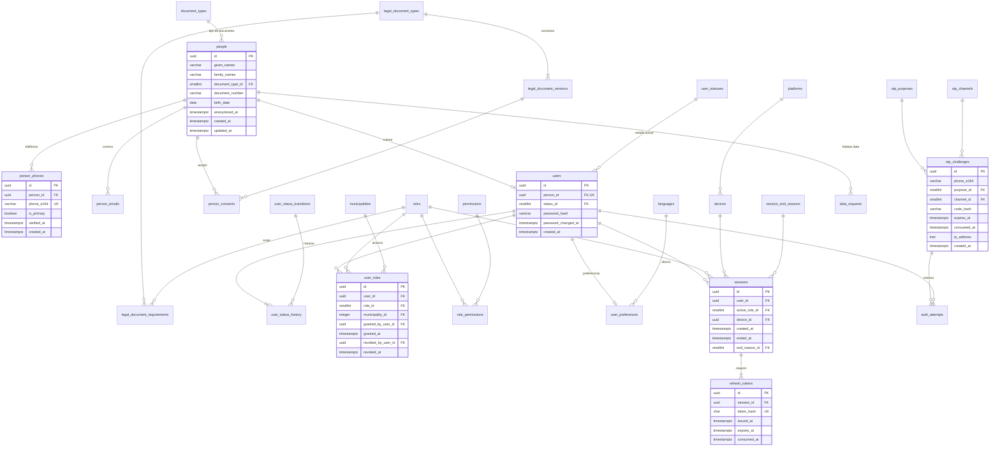
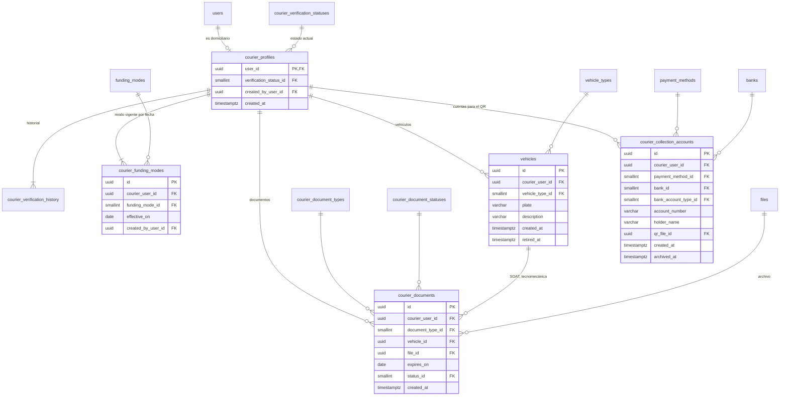

# E01 · Identidad y acceso

Historias: H01.1 (OTP), H01.2 (roles y permisos), H01.3 (domiciliarios), H01.4 (panel), H01.5 (mi cuenta), H08.7 (modo cliente). Módulo de la API: `identity`.

## La separación central: `people` ≠ `users`

| Tabla | Responde | Contiene | No contiene |
| --- | --- | --- | --- |
| `people` | ¿Quién es esta persona? | Nombres, documento de identidad, fecha de nacimiento, fecha de anonimización | Nada de acceso |
| `person_phones` / `person_emails` | ¿Cómo se le contacta? | Teléfonos E.164 y correos, con fecha de verificación | |
| `users` | ¿Puede entrar al sistema? | Persona a la que pertenece, estado de la cuenta, hash de contraseña | Nombre, teléfono, documento |
| `user_roles` | ¿Qué puede hacer? | Roles otorgados, alcance por municipio, quién y cuándo | |
| `sessions` / `refresh_tokens` | ¿Con qué sesión entró? | Sesión, rol activo, dispositivo, tokens rotativos | |
| `courier_profiles` y sus hijas | ¿Cómo trabaja como domiciliario? | Verificación, modo de financiación, vehículo, documentos, cuentas de cobro | |

**Inicio de sesión:** el número que escribe la persona se busca en `person_phones.phone_e164` → `people` → `users`. El teléfono es un dato personal, no una credencial, por eso vive en `person_phones` y no en `users`.

## Diagrama: persona, cuenta, roles y sesiones



## Tablas

### `people`

| Columna | Tipo | Nulo | Regla |
| --- | --- | --- | --- |
| `id` | `uuid` | no | PK |
| `given_names` | `varchar(80)` | no | |
| `family_names` | `varchar(80)` | sí | Los clientes pueden dar solo un nombre |
| `document_type_id` | FK `document_types` | sí | Obligatorio para domiciliarios y personal (lo exige el caso de uso H01.3) |
| `document_number` | `varchar(20)` | sí | `UNIQUE (document_type_id, document_number)`; `CHECK ((document_type_id IS NULL) = (document_number IS NULL))` |
| `birth_date` | `date` | sí | |
| `anonymized_at` | `timestamptz` | sí | Fecha en que se borraron sus datos (H01.5) |
| `created_at`, `updated_at` | `timestamptz` | no | |

`document_types` (sistema): `CC` (cédula de ciudadanía), `CE` (cédula de extranjería), `PASSPORT`, `PPT` (permiso por protección temporal), `TI` (tarjeta de identidad). Columna extra: `country_id` nullable.

### `person_phones` y `person_emails`

| Tabla | Columna | Tipo | Nulo | Regla |
| --- | --- | --- | --- | --- |
| `person_phones` | `person_id` | FK `people` | no | |
| | `phone_e164` | `varchar(16)` | no | `UNIQUE` global; `CHECK` E.164 |
| | `is_primary` | `boolean` | no | Índice único parcial `(person_id) WHERE is_primary` |
| | `verified_at` | `timestamptz` | sí | Se llena al validar un OTP enviado a ese número |
| `person_emails` | `person_id` | FK `people` | no | |
| | `email` | `citext` | no | `UNIQUE` global |
| | `is_primary` | `boolean` | no | Índice único parcial `(person_id) WHERE is_primary` |
| | `verified_at` | `timestamptz` | sí | |

El país del teléfono no se guarda: se deduce del prefijo E.164.

### `users`

| Columna | Tipo | Nulo | Regla |
| --- | --- | --- | --- |
| `id` | `uuid` | no | PK |
| `person_id` | FK `people` | no | `UNIQUE` (una persona, una cuenta) |
| `status_id` | FK `user_statuses` | no | Estado actual; lo escribe el disparador del historial |
| `password_hash` | `varchar(255)` | sí | Argon2id. Obligatorio si alguno de sus roles tiene `requires_password` (regla del caso de uso) |
| `password_changed_at` | `timestamptz` | sí | `CHECK ((password_hash IS NULL) = (password_changed_at IS NULL))` |
| `created_at` | `timestamptz` | no | |

La última conexión **no** se guarda en `users`: es la última sesión.

### Estados de la cuenta

`user_statuses` (sistema) con la columna extra `can_sign_in boolean`:

| code | is_initial | is_terminal | can_sign_in | Uso |
| --- | --- | --- | --- | --- |
| `ACTIVE` | sí | no | sí | Cuenta normal |
| `SUSPENDED` | no | no | no | Bloqueo temporal por el administrador |
| `DEACTIVATED` | no | no | no | Desactivada por el administrador (domiciliario u operador que se retira, H01.3, H01.4) |
| `CLOSED` | no | sí | no | El titular pidió eliminar sus datos (H01.5) |

`user_status_transitions`: `ACTIVE→SUSPENDED`, `SUSPENDED→ACTIVE`, `ACTIVE→DEACTIVATED`, `SUSPENDED→DEACTIVATED`, `DEACTIVATED→ACTIVE`, `ACTIVE→CLOSED`, `SUSPENDED→CLOSED`, `DEACTIVATED→CLOSED`.

`user_status_history`: `id`, `user_id`, `from_status_id` (nulo solo en la primera fila), `to_status_id`, `changed_by_user_id` (nulo si fue el sistema), `reason varchar(300)`, `changed_at`. FK compuesta `(from_status_id, to_status_id)` → `user_status_transitions`.

Al pasar a un estado con `can_sign_in = false`, el mismo caso de uso cierra todas las sesiones abiertas con motivo `ACCOUNT_DISABLED` (H01.3: "sus sesiones quedan revocadas").

### Roles y permisos

| Tabla | Columnas | Regla |
| --- | --- | --- |
| `roles` (sistema) | `id`, `code`, `requires_password boolean`, `is_self_assignable boolean`, `is_staff boolean`, `requires_municipality boolean`, `sort_order` | |
| `permissions` (sistema) | `id`, `code` (`orders.assign`), `module varchar(40)` | `code` único |
| `role_permissions` | `role_id`, `permission_id` | PK compuesta |
| `user_roles` | `id`, `user_id`, `role_id`, `municipality_id`, `granted_by_user_id`, `granted_at`, `revoked_by_user_id`, `revoked_at` | Índice único parcial `(user_id, role_id, municipality_id) NULLS NOT DISTINCT WHERE revoked_at IS NULL` (sin `NULLS NOT DISTINCT` se podrían duplicar los roles con alcance nulo). `municipality_id` obligatorio si el rol `requires_municipality`, y un solo rol `COURIER` vigente por usuario (disparador, bloqueando la fila de `users`). `CHECK ((revoked_at IS NULL) = (revoked_by_user_id IS NULL))` |

Semilla de `roles`:

| code | requires_password | is_self_assignable | is_staff | requires_municipality |
| --- | --- | --- | --- | --- |
| `CUSTOMER` | no | sí | no | no |
| `COURIER` | sí | no | no | sí |
| `OPERATOR` | sí | no | sí | sí |
| `ADMIN` | sí | no | sí | no |

- `municipality_id` es el alcance del rol: un operador de Villagarzón no ve pedidos de otro municipio (RF-98). Es nulo para `CUSTOMER` (puede pedir en cualquier municipio) y para un `ADMIN` global.
- `granted_by_user_id` es nulo solo cuando el cliente se registra solo (`CUSTOMER`, `is_self_assignable`).
- **Modo cliente (H08.7, RF-06):** el domiciliario tiene los roles `COURIER` y `CUSTOMER`. Cambiar de modo es abrir el token con otro `sessions.active_role_id`. Ningún endpoint otorga `COURIER` a quien no lo tiene, porque ese rol no es `is_self_assignable` (H01.3).
- Los guards de NestJS (H01.2) verifican **permisos** del rol activo, cargados en memoria desde `role_permissions`. La regla de propiedad ("un cliente solo ve sus pedidos", respuesta 404) es del caso de uso, no de la base de datos.

Semilla de `permissions` y `role_permissions`:

| Permiso | CUSTOMER | COURIER | OPERATOR | ADMIN |
| --- | --- | --- | --- | --- |
| `account.manage_own` | ✓ | ✓ | ✓ | ✓ |
| `orders.create`, `orders.read_own`, `orders.confirm_delivery`, `adjustments.decide`, `incidents.report` | ✓ | | | |
| `offers.respond`, `orders.progress`, `location.report`, `adjustments.report`, `cash.read_own` | | ✓ | | |
| `orders.read_all`, `orders.assign`, `orders.cancel`, `deliveries.review`, `incidents.resolve`, `couriers.read_location` | | | ✓ | ✓ |
| `establishments.manage`, `products.manage` | | | ✓ | ✓ |
| `users.manage_staff`, `couriers.manage`, `couriers.verify`, `zones.manage`, `hours.manage`, `settings.manage`, `commission.manage`, `cash.manage`, `cash.adjust`, `audit.read`, `legal.manage` | | | | ✓ |

### OTP, intentos y sesiones

**`otp_challenges`** (H01.1, RF-01). El número aún puede no existir en `person_phones` (registro), por eso se guarda `phone_e164` tal cual lo pidió la persona.

| Columna | Tipo | Nulo | Regla |
| --- | --- | --- | --- |
| `phone_e164` | `varchar(16)` | no | `CHECK` E.164. Índice `(phone_e164, created_at)` para el límite de 3 envíos por hora |
| `purpose_id` | FK `otp_purposes` | no | `SIGN_IN`, `STAFF_SIGN_IN`, `PHONE_CHANGE` |
| `channel_id` | FK `otp_channels` | no | `SMS`, `WHATSAPP` |
| `code_hash` | `varchar(255)` | sí | Hash del código cuando lo genera la API. Con un proveedor que genera y valida el código (Twilio Verify) queda nulo y se guarda `provider_message_id`. `CHECK (num_nonnulls(code_hash, provider_message_id) >= 1)`. Nunca el código en claro |
| `provider_message_id` | `varchar(100)` | sí | Id de la verificación en el proveedor |
| `expires_at` | `timestamptz` | no | `created_at + 5 min` ([excepción](README.md#excepciones-deliberadas)) |
| `consumed_at` | `timestamptz` | sí | Se llena una sola vez al validar |
| `ip_address` | `inet` | sí | |

**`auth_attempts`** guarda cada intento de código o contraseña. Los "5 intentos" y el bloqueo por contraseña se **cuentan**; no hay contador guardado.

| Columna | Tipo | Nulo | Regla |
| --- | --- | --- | --- |
| `id` | `bigint` identity | no | PK |
| `auth_factor_id` | FK `auth_factors` | no | `OTP`, `PASSWORD` |
| `otp_challenge_id` | FK `otp_challenges` | sí | `CHECK` obligatorio si el factor es `OTP` (por disparador, el factor es un catálogo) |
| `user_id` | FK `users` | sí | Obligatorio si el factor es `PASSWORD` |
| `succeeded` | `boolean` | no | Resultado del intento (propiedad del hecho, no un estado) |
| `ip_address` | `inet` | sí | |
| `attempted_at` | `timestamptz` | no | |

**`devices`**: una instalación de la app o un navegador. No pertenece a un usuario; se relaciona con usuarios a través de sus sesiones (un teléfono puede usarlo el domiciliario en modo domiciliario y en modo cliente).

| Columna | Tipo | Nulo | Regla |
| --- | --- | --- | --- |
| `installation_id` | `uuid` | no | `UNIQUE`; lo genera la app la primera vez |
| `platform_id` | FK `platforms` | no | `ANDROID`, `IOS`, `WEB` |
| `app_version` | `varchar(20)` | sí | |
| `created_at`, `last_seen_at` | `timestamptz` | no | |

**`sessions`** (RF-02):

| Columna | Tipo | Nulo | Regla |
| --- | --- | --- | --- |
| `user_id` | FK `users` | no | |
| `active_role_id` | FK `roles` | no | Debe ser un rol vigente del usuario (se valida al crear y en cada refresco) |
| `device_id` | FK `devices` | sí | |
| `created_at` | `timestamptz` | no | |
| `ended_at` | `timestamptz` | sí | `CHECK ((ended_at IS NULL) = (end_reason_id IS NULL))` |
| `end_reason_id` | FK `session_end_reasons` | sí | `SIGN_OUT`, `REFRESH_REUSE_DETECTED`, `ACCOUNT_DISABLED`, `ROLE_REVOKED`, `EXPIRED`, `PASSWORD_CHANGED` |

**`refresh_tokens`**: un token por rotación. El token vigente de una sesión es el que no tiene `consumed_at` (índice único parcial `(session_id) WHERE consumed_at IS NULL`). Si llega un token ya consumido, se cierra la sesión con `REFRESH_REUSE_DETECTED`.

| Columna | Tipo | Nulo | Regla |
| --- | --- | --- | --- |
| `session_id` | FK `sessions` | no | |
| `token_hash` | `char(64)` | no | `UNIQUE`; SHA-256 del token |
| `issued_at`, `expires_at` | `timestamptz` | no | `expires_at = issued_at + 30 días` |
| `consumed_at` | `timestamptz` | sí | |

### Preferencias

`user_preferences` (1:1 con `users`): `user_id` PK, `language_id` FK `languages`, `display_currency_id` FK `currencies` nulo (moneda del precio aproximado, H03.4), `updated_at`. Es de la cuenta y no de la persona porque describe cómo usa la app.

### Consentimientos (Ley 1581, RF-07)

| Tabla | Columnas | Regla |
| --- | --- | --- |
| `legal_document_types` (sistema) | `code`: `TERMS_OF_SERVICE`, `DATA_PROCESSING_POLICY`, `COURIER_LOCATION_AUTHORIZATION` | |
| `legal_document_requirements` | `legal_document_type_id`, `role_id` | PK compuesta. Qué documentos debe aceptar quien tiene cada rol |
| `legal_document_versions` | `id`, `legal_document_type_id`, `version_label`, `file_id` (nulable), `published_at`, `created_by_user_id` | `UNIQUE (legal_document_type_id, version_label)`. Vigente: la última con `published_at <= now()`. Sin `file_id`, el texto de esa versión es el que publican la web y la app en `/legal/<documento>`; con archivo, se muestra el PDF |
| `person_consents` | `id`, `person_id`, `legal_document_version_id`, `accepted_at`, `ip_address`, `revoked_at` | Índice único parcial `(person_id, legal_document_version_id) WHERE revoked_at IS NULL` (se puede volver a aceptar tras revocar) |

El consentimiento es de la **persona** (el titular de los datos), no de la cuenta. Cuando se publica una versión nueva, el caso de uso pide aceptarla en el siguiente inicio de sesión.

### Solicitudes del titular (H01.5)

| Tabla | Columnas |
| --- | --- |
| `data_request_types` (sistema) | `ACCESS`, `RECTIFICATION`, `DELETION`, `CONSENT_REVOCATION` |
| `data_request_statuses` (sistema) | `RECEIVED` (inicial), `IN_PROGRESS`, `COMPLETED` (terminal), `REJECTED` (terminal) |
| `data_requests` | `id`, `person_id`, `request_type_id`, `status_id`, `details text`, `requested_at`, `resolved_by_user_id`, `resolved_at`. Estado de nivel simple: `resolved_*` llenos si y solo si el estado es terminal (disparador) |

**Eliminación = anonimización.** El procedimiento `anonymize_person(person_id)` hace en una transacción:

| Dónde | Qué |
| --- | --- |
| `people` | `given_names = 'Anónimo'`, `family_names`, documento y fecha de nacimiento en nulo, `anonymized_at` lleno |
| `person_phones`, `person_emails` | Se borran las filas |
| `addresses` | Se archivan; `line` y `reference` en nulo y `location` al centro del municipio ([E04](E04-pedido-del-cliente.md#addresses)) |
| `customer_recipients` | Se archivan con `full_name = 'Anónimo'` y `phone_e164` en nulo (son datos de terceros que dio el cliente) |
| `orders.customer_notes`, `order_items.notes` | En nulo |
| `sessions`, `refresh_tokens` | Se cierran todas las sesiones |
| `courier_collection_accounts` | `holder_name` y `account_number` en blanco (domiciliarios) |
| `files` de `COURIER_DOCUMENT` | Se borran del almacenamiento y de la tabla |
| `users` | Pasa a `CLOSED` |

Los pedidos, sus montos y los movimientos de caja se conservan para la contabilidad. Las fotos de entrega y de facturas se conservan mientras dure el plazo de reclamos y se borran con su retención.

**Retención de registros de acceso:** `otp_challenges` y `auth_attempts` (con teléfonos e IP) se borran a los `security.auth_log_retention_days` (90) con un trabajo diario.

## Diagrama: domiciliarios



### `courier_profiles` (H01.3, RF-04)

| Columna | Tipo | Nulo | Regla |
| --- | --- | --- | --- |
| `user_id` | FK `users` | no | PK. El usuario debe tener el rol `COURIER` vigente |
| `verification_status_id` | FK `courier_verification_statuses` | no | Estado actual (disparador del historial) |
| `created_by_user_id` | FK `users` | no | Siempre un administrador; no hay registro abierto |
| `created_at` | `timestamptz` | no | |

El municipio donde trabaja es el alcance de su rol `COURIER` en `user_roles`; no se repite aquí.

Estado de nivel completo (con historial): la verificación decide quién puede salir a la calle con dinero de RapiChonta.

`courier_verification_statuses` (sistema), columna extra `can_receive_offers boolean`:

| code | is_initial | can_receive_offers |
| --- | --- | --- |
| `PENDING` | sí | no |
| `VERIFIED` | no | sí |
| `SUSPENDED` | no | no |
| `REJECTED` | no | no |

Transiciones: `PENDING→VERIFIED`, `PENDING→REJECTED`, `VERIFIED→SUSPENDED`, `SUSPENDED→VERIFIED`, `REJECTED→PENDING`. Historial: `courier_verification_history` con el patrón estándar.

Un domiciliario **puede recibir ofertas** si y solo si su cuenta tiene `can_sign_in`, su verificación tiene `can_receive_offers` y su rol `COURIER` está vigente. Se expone como la vista `v_dispatchable_couriers`.

### Modo de financiación versionado

`funding_modes` (sistema): `CASH_BOX` (RapiChonta entrega una base diaria), `OWN_FUNDS` (compra con su dinero).

`courier_funding_modes`: `id`, `courier_user_id`, `funding_mode_id`, `effective_on date`, `created_by_user_id`, `created_at`, con `UNIQUE (courier_user_id, effective_on)`. El modo de un día es la última fila con `effective_on <= business_date`; un cambio rige desde el día siguiente al cierre de la caja abierta. Así la caja de un día pasado sigue sabiendo con qué modo trabajó aunque el modo cambie después ([E11](E11-cajas-y-comisiones.md)).

### Vehículos, documentos y cuentas de cobro

| Tabla | Regla clave |
| --- | --- |
| `vehicle_types` (sistema) | `MOTORCYCLE`, `BICYCLE`, `CAR`, `ON_FOOT`; columna `requires_plate boolean` |
| `vehicles` | Un solo vehículo vigente: índice único parcial `(courier_user_id) WHERE retired_at IS NULL`. Placa obligatoria si el tipo `requires_plate` (disparador). `UNIQUE (plate) WHERE retired_at IS NULL` |
| `courier_document_types` (sistema) | `ID_CARD`, `DRIVER_LICENSE`, `SOAT`, `TECHNICAL_INSPECTION`, `VEHICLE_REGISTRATION`; columnas `requires_expiry boolean`, `is_vehicle_document boolean` |
| `courier_document_statuses` (sistema) | `PENDING_REVIEW` (inicial), `APPROVED`, `REJECTED`. "Vencido" no es un estado: se calcula con `expires_on < current_date` |
| `courier_documents` | `vehicle_id` obligatorio si el tipo `is_vehicle_document`; `expires_on` obligatorio si `requires_expiry` (disparador). FK compuesta `(vehicle_id, courier_user_id)` → `vehicles (id, courier_user_id)` (con `UNIQUE (id, courier_user_id)` en `vehicles`): el vehículo debe ser del mismo domiciliario. Estado de nivel simple: quién lo aprobó queda en `audit_logs` |
| `banks` (negocio) | `code`, `name`, `ach_code` |
| `bank_account_types` (sistema) | `SAVINGS`, `CHECKING` |
| `courier_collection_accounts` | `payment_method_id` es el medio que esa cuenta recibe y debe ser `is_account_based` (`NEQUI`, `DAVIPLATA`, `BANK_TRANSFER`). `bank_id` y `bank_account_type_id` obligatorios solo si el medio `requires_bank` (disparador). Una cuenta vigente por medio: índice único parcial `(courier_user_id, payment_method_id) WHERE archived_at IS NULL` |

`payment_methods` está en [00 · Transversal](00-transversal.md#medios-de-pago) porque lo usan E01, E04, E10 y E11.

## Vistas

| Vista | Para qué |
| --- | --- |
| `v_user_identity` | Usuario con nombre, teléfono principal, estado y roles vigentes (panel y "Mi cuenta") |
| `v_active_user_roles` | Roles con `revoked_at IS NULL` y su alcance |
| `v_dispatchable_couriers` | Domiciliarios que pueden recibir ofertas (ver arriba) |
| `v_current_courier_funding_mode` | Modo de financiación vigente de cada domiciliario |
| `v_pending_consents` | Por usuario, documentos legales exigidos por sus roles cuya versión vigente no ha aceptado |

## Consultas clave

Buscar la cuenta por teléfono al validar el OTP:

```sql
SELECT u.id, u.status_id
FROM person_phones pp
JOIN users u ON u.person_id = pp.person_id
WHERE pp.phone_e164 = :phone;
```

Intentos fallidos del código en curso (bloquear al quinto):

```sql
SELECT count(*) FROM auth_attempts
WHERE otp_challenge_id = :challenge AND NOT succeeded;
```

Códigos enviados a un número en la última hora (máximo 3):

```sql
SELECT count(*) FROM otp_challenges
WHERE phone_e164 = :phone AND created_at > now() - interval '1 hour';
```

## Registro de un cliente (H01.1), en una transacción

1. `people` (nombre que escribe en el checkout).
2. `person_phones` con `verified_at = now()` y `is_primary = true`.
3. `users` y la primera fila de `user_status_history` (`NULL → ACTIVE`).
4. `user_roles` con `CUSTOMER` y `granted_by_user_id` nulo.
5. `user_preferences` con el idioma del dispositivo.
6. `person_consents` de la versión vigente de `TERMS_OF_SERVICE` y `DATA_PROCESSING_POLICY`.
7. `sessions` + `refresh_tokens`.

## API (implementada en E01)

Prefijo `/api/v1`. Los errores responden `{ code, details }` y cada cliente traduce el `code`. Las búsquedas por nombre usan la extensión `unaccent` (además de `citext`) para que "Ramirez" encuentre "Ramírez".

| Ruta | Acceso | Para qué |
| --- | --- | --- |
| `POST /auth/otp` | Pública, límite estricto | Envía el código (3 por hora por número) |
| `POST /auth/otp/verify` | Pública | Verifica el código: devuelve la sesión o pide registro |
| `POST /auth/register` | Pública | Crea el cliente con sus consentimientos (transacción de arriba) |
| `POST /auth/password` y `/auth/password/verify` | Pública | Ingreso del personal y del domiciliario: contraseña y luego código |
| `POST /auth/refresh` | Pública | Rota el refresco; reutilizar uno ya usado cierra la sesión |
| `POST /auth/sign-out` | Pública | Revoca la sesión actual |
| `POST /auth/switch-role` | Sesión | Domiciliario ↔ modo cliente (`sessions.active_role_id`) |
| `GET /legal/current` | Pública | Versiones vigentes de los documentos legales |
| `GET /me`, `PATCH /me/profile`, `PUT /me/language` | `ACCOUNT_MANAGE_OWN` | Mi cuenta |
| `POST /me/phone/otp` y `/me/phone/verify` | `ACCOUNT_MANAGE_OWN` | Cambio de celular con código al número nuevo |
| `PUT /me/password` | `ACCOUNT_MANAGE_OWN` | Cambia la contraseña y cierra las demás sesiones (`PASSWORD_CHANGED`) |
| `POST /me/consents` | `ACCOUNT_MANAGE_OWN` | Acepta versiones nuevas pendientes |
| `POST /me/data-deletion` | `ACCOUNT_MANAGE_OWN` | Anonimiza a la persona y cierra todas sus sesiones |
| `GET/POST /admin/couriers`, `GET /admin/couriers/:id` | `COURIERS_MANAGE` | Alta y consulta de domiciliarios |
| `POST /admin/couriers/:id/verification` | `COURIERS_VERIFY` | Verifica o rechaza al domiciliario |
| `POST /admin/users/:id/status` | Según el rol de la cuenta | Activa, suspende o desactiva; desactivar revoca las sesiones |
| `GET/POST /admin/staff` | `USERS_MANAGE_STAFF` (solo administrador) | Operadores y administradores |

El token web de refresco viaja en la cookie `rc_refresh` (`HttpOnly`, `SameSite=Strict`, ruta `/api/v1/auth`); la app lo recibe en el cuerpo y lo guarda en Keystore/Keychain. Un recurso de otra persona responde 404, no 403, para no revelar que existe.
