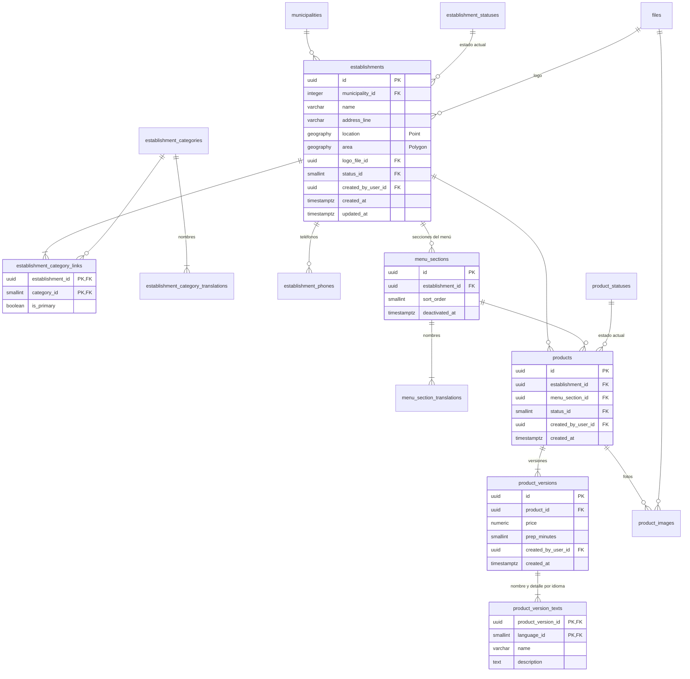

# E02 · Establecimientos y menús

Historias: H02.1 a H02.6. Módulo de la API: `catalog`.

## Diagrama



## Tablas

### `establishments` (H02.1, RF-10)

| Columna | Tipo | Nulo | Regla |
| --- | --- | --- | --- |
| `id` | `uuid` | no | PK |
| `municipality_id` | FK `municipalities` | no | |
| `name` | `varchar(120)` | no | Nombre comercial (nombre propio: no se traduce) |
| `address_line` | `varchar(200)` | no | Dirección en texto para el domiciliario |
| `location` | `geography(Point)` | no | Punto del mapa y de las distancias. GIST |
| `area` | `geography(Polygon)` | no | Área dibujada a mano (local y entrada) para la geocerca. GIST. `CHECK (ST_Covers(area, location))` |
| `logo_file_id` | FK `files` | sí | Propósito `ESTABLISHMENT_LOGO` |
| `status_id` | FK `establishment_statuses` | no | Estado actual (disparador del historial) |
| `created_by_user_id` | FK `users` | no | |
| `created_at`, `updated_at` | `timestamptz` | no | |

Ya no existe `is_partner`: ser comercio aliado es un hecho con fechas ([E15](E13-E15-fases-futuras.md#e15--comercios-aliados)).

### Estados del establecimiento

`establishment_statuses` (sistema), columnas extra `is_visible_on_map boolean`, `accepts_orders boolean`:

| code | is_initial | is_visible_on_map | accepts_orders | Uso |
| --- | --- | --- | --- | --- |
| `DRAFT` | sí | no | no | Se está cargando el menú (H02.6) |
| `ACTIVE` | no | sí | sí | Normal |
| `TEMPORARILY_CLOSED` | no | sí | no | Cerrado hoy, vacaciones, reformas |
| `INACTIVE` | no | no | no | Ya no trabaja con RapiChonta |

Estado de [nivel simple](README.md#catálogo-de-estados--historial--estado-actual): el dominio permite `DRAFT→ACTIVE`, `ACTIVE↔TEMPORARILY_CLOSED`, `ACTIVE→INACTIVE`, `TEMPORARILY_CLOSED→INACTIVE` e `INACTIVE→ACTIVE`, y cada cambio queda en `audit_logs` (`ESTABLISHMENT_CHANGED`).

### Categorías (H02.4, RF-12)

| Tabla | Columnas | Regla |
| --- | --- | --- |
| `establishment_categories` (negocio) | `id`, `code`, `icon varchar(40)`, `sort_order`, `deactivated_at` | Semilla: `FAST_FOOD`, `RESTAURANT`, `SUPERMARKET`, `STORE`, `PHARMACY` |
| `establishment_category_translations` | `category_id`, `language_id`, `name` | PK compuesta |
| `establishment_category_links` | `establishment_id`, `category_id`, `is_primary` | PK compuesta. Un local puede tener varias categorías (tienda y droguería). Índice único parcial `(establishment_id) WHERE is_primary`: la principal define el ícono del mapa |

### Teléfonos del local

`establishment_phones`: `id`, `establishment_id`, `phone_e164` (`CHECK` E.164), `label varchar(40)`, `UNIQUE (establishment_id, phone_e164)`. Para que el domiciliario u operador llame.

### Menú (H02.2, RF-11)

| Tabla | Columnas | Regla |
| --- | --- | --- |
| `menu_sections` | `id`, `establishment_id`, `sort_order`, `created_at`, `deactivated_at` | `UNIQUE (id, establishment_id)` para la llave compuesta de `products` |
| `menu_section_translations` | `menu_section_id`, `language_id`, `name` | PK compuesta; "Hamburguesas", "Bebidas" |
| `products` | `id`, `establishment_id`, `menu_section_id`, `status_id`, `created_by_user_id`, `created_at` | FK compuesta `(menu_section_id, establishment_id)` → `menu_sections (id, establishment_id)`: la sección debe ser del mismo local |
| `product_images` | `product_id`, `file_id`, `sort_order` | PK `(product_id, file_id)`; la de menor `sort_order` es la principal (H02.3) |

### Productos versionados

`products` es la identidad estable del producto. **Todo lo que puede cambiar y que el cliente acepta al pedir** (nombre, detalle, precio, tiempo de preparación) es una versión inmutable:

| Tabla | Columna | Tipo | Nulo | Regla |
| --- | --- | --- | --- | --- |
| `product_versions` | `product_id` | FK `products` | no | |
| | `price` | `numeric(12,2)` | no | `CHECK (price > 0)`, COP |
| | `prep_minutes` | `smallint` | no | `CHECK (prep_minutes BETWEEN 0 AND 240)` |
| | `created_by_user_id` | FK `users` | no | |
| | `created_at` | `timestamptz` | no | `UNIQUE (product_id, created_at)` |
| `product_version_texts` | `product_version_id` | FK `product_versions` | no | PK `(product_version_id, language_id)` |
| | `language_id` | FK `languages` | no | Debe existir el texto en `es` (disparador diferido al confirmar) |
| | `name` | `varchar(120)` | no | |
| | `description` | `text` | sí | |

- Cambiar el precio o el nombre = insertar una versión nueva. Lo vigente se lee en `v_current_product_versions`.
- Los pedidos apuntan a la versión ([E04](E04-pedido-del-cliente.md#order_items)): el pedido conserva lo que el cliente aceptó **sin copiar** nombre, precio ni tiempo (reemplaza la copia que hacía `OrderItem` en el esquema provisional).
- Las versiones son inmutables (disparador que rechaza `UPDATE` y `DELETE`).

### Disponibilidad del producto

La disponibilidad cambia varias veces al día y no altera lo que el cliente pidió antes, por eso es un **estado** y no una versión.

`product_statuses` (sistema), columnas extra `is_visible boolean`, `is_orderable boolean`:

| code | is_initial | is_visible | is_orderable |
| --- | --- | --- | --- |
| `AVAILABLE` | sí | sí | sí |
| `SOLD_OUT` | no | sí | no |
| `DISCONTINUED` | no | no | no |

Estado de nivel simple: el dominio permite `AVAILABLE↔SOLD_OUT` y `→DISCONTINUED` (terminal). Cambia varias veces al día, así que no lleva historial; la métrica de producto faltante por local (RF-83) sale de los reportes de [E09](E09-producto-faltante.md).

## Vistas

| Vista | Contenido |
| --- | --- |
| `v_current_product_versions` | `DISTINCT ON (product_id) ... ORDER BY product_id, created_at DESC` |
| `v_menu` | Establecimiento, sección, producto, versión vigente con textos, foto principal, estado; solo `is_visible` |
| `v_map_establishments` | Establecimientos cuyo estado `is_visible_on_map`, con `location`, `accepts_orders` y categoría principal, en municipios con `launched_at` (incluye los cerrados temporalmente, que se ven sin poder pedir) |

## Consultas clave

Cercanos (reemplaza la consulta actual con `is_active`; usa la vista para no repetir las reglas de visibilidad):

```sql
SELECT e.id, e.name, e.accepts_orders, ST_Distance(e.location, :origen) AS distancia
FROM v_map_establishments e
WHERE ST_DWithin(e.location, :origen, :radio_metros)
ORDER BY distancia
LIMIT 50;
```

Filtrar por categoría (H02.4):

```sql
... JOIN establishment_category_links l ON l.establishment_id = e.id
JOIN establishment_categories c ON c.id = l.category_id AND c.code = :categoria
```

¿El domiciliario ya llegó al local? (H08.3):

```sql
SELECT ST_Covers(area, :posicion) FROM establishments WHERE id = :id;
```

## Carga inicial (H02.6)

La semilla del piloto crea cada local en `DRAFT`, sus secciones, productos y primera versión con texto en `es`, y al final pasa los locales listos a `ACTIVE`.
