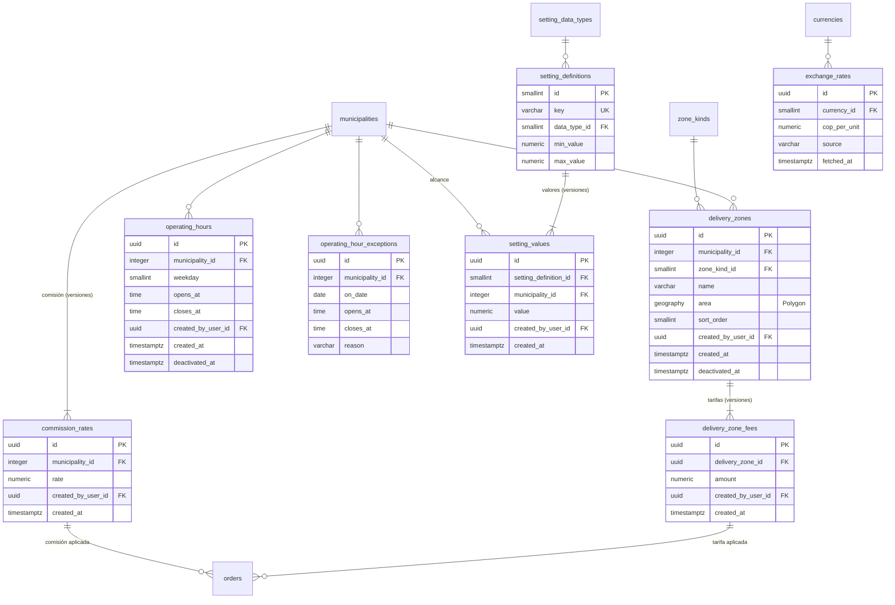

# E03 · Zonas, horario y configuración del negocio

Historias: H03.1 a H03.4 y la carga de valores del piloto (H12.1). Módulo de la API: `business-config`.

Todo lo de esta épica pertenece a un municipio y todo lo que cambia con el tiempo se **versiona**: un pedido apunta a la tarifa y a la comisión con que se creó, y la caja de un día pasado se puede recalcular igual.

## Diagrama



## Zonas de entrega (H03.1, RF-14)

| Tabla | Columna | Tipo | Nulo | Regla |
| --- | --- | --- | --- | --- |
| `zone_kinds` (sistema) | `code` | | | `URBAN` (barrios del casco urbano), `RURAL` (veredas y lugares aledaños) |
| `delivery_zones` | `municipality_id` | FK | no | |
| | `zone_kind_id` | FK `zone_kinds` | no | |
| | `name` | `varchar(80)` | no | Índice único parcial `(municipality_id, name) WHERE deactivated_at IS NULL` (una zona dada de baja puede renacer con el mismo nombre y otro polígono) |
| | `area` | `geography(Polygon)` | no | GIST. Dos zonas activas del mismo municipio no se pueden superponer (disparador con `ST_Intersects` y área de intersección ≥ 1 m²; el margen absorbe el redondeo a 6 decimales de los vértices compartidos) |
| | `sort_order` | `smallint` | no | |
| | `deactivated_at` | `timestamptz` | sí | Una zona se da de baja, no se borra (hay pedidos que apuntan a sus tarifas) |
| `delivery_zone_fees` | `delivery_zone_id` | FK | no | |
| | `amount` | `numeric(12,2)` | no | `CHECK (amount > 0)` |
| | `created_by_user_id` | FK `users` | no | |
| | `created_at` | `timestamptz` | no | `DEFAULT clock_timestamp()`, `UNIQUE (delivery_zone_id, created_at)`. Inmutable |

- Si el polígono de una zona cambia, se da de baja la zona y se crea otra (los pedidos viejos conservan la zona y el área con que se calcularon).
- "Cambiar la tarifa" = insertar en `delivery_zone_fees`. La vigente está en `v_current_zone_fees`.
- Al guardar, la API avisa con `ZONE_OVERLAP` qué zonas pisa y cuántos m². El panel ofrece recortarla: con `trimOverlaps` la API guarda `ST_Difference` contra las zonas activas calculado en SQL a precisión completa (si queda vacía o partida en varias piezas responde `ZONE_TRIM_EMPTY` / `ZONE_TRIM_SPLIT`).
- El pedido guarda solo `delivery_zone_fee_id`. La zona del pedido se obtiene a través de la tarifa; no se guarda `delivery_zone_id` en el pedido (sería redundante).

Tarifa para una dirección (H04.2):

```sql
SELECT f.id AS delivery_zone_fee_id, f.amount
FROM delivery_zones z
JOIN v_current_zone_fees f ON f.delivery_zone_id = z.id
WHERE z.deactivated_at IS NULL
  AND z.municipality_id = :municipio_del_establecimiento
  AND ST_Covers(z.area, :punto);
-- Sin filas: la dirección está fuera de cobertura y no se puede pedir.
```

## Horario de operación (H03.2, RF-15)

| Tabla | Regla |
| --- | --- |
| `operating_hours` | Varias franjas por día (`08:00–14:00` y `16:00–22:00`). `CHECK (closes_at > opens_at)`: una franja que cruza la medianoche se registra como dos. Franjas del mismo día y municipio no se superponen: restricción `EXCLUDE` con el tipo `timerange` ([README](README.md#concurrencia)). Cambiar el horario = dar de baja la franja (`deactivated_at`) y crear otra; quién lo hizo queda en `audit_logs` |
| `operating_hour_exceptions` | Festivos y cierres: `on_date`, `opens_at` y `closes_at` ambos nulos = cerrado todo el día; ambos llenos = horario especial. `CHECK ((opens_at IS NULL) = (closes_at IS NULL))`. `UNIQUE (municipality_id, on_date, opens_at) NULLS NOT DISTINCT`; un día no puede mezclar "cerrado" con franjas especiales (disparador, bloqueando el municipio) |

Las horas se interpretan en `municipalities.time_zone`. La "próxima hora de apertura" que muestra el botón de pedir se calcula en el caso de uso (`OpeningCalendar`) a partir de estas dos tablas: une franjas contiguas (también las que cruzan la medianoche) y busca hasta 14 días adelante. `GET /business/status` la expone; E04 rechaza pedidos fuera de horario con `EnsureOpenForOrders` (`OUTSIDE_OPERATING_HOURS`). En la API, "24:00" como cierre significa fin del día.

## Parámetros del negocio (H03.3, RF-16)

Reemplaza `AppSetting` (clave + `Json`) por definiciones tipadas y valores versionados:

| Tabla | Columna | Tipo | Nulo | Regla |
| --- | --- | --- | --- | --- |
| `setting_data_types` (sistema) | `code` | | | `INTEGER`, `MONEY_COP`, `SECONDS`, `METERS`, `DAYS` |
| `setting_definitions` (sistema) | `key` | `varchar(60)` | no | `UNIQUE` |
| | `data_type_id` | FK | no | |
| | `min_value`, `max_value` | `numeric(14,4)` | sí | El caso de uso valida el valor contra el rango |
| | `is_scoped_by_municipality` | `boolean` | no | Si puede tener un valor distinto por municipio |
| `setting_values` | `setting_definition_id` | FK | no | |
| | `municipality_id` | FK | sí | `NULL` = valor global. Solo lleno si la definición `is_scoped_by_municipality` |
| | `value` | `numeric(14,4)` | no | |
| | `created_by_user_id` | FK `users` | sí | `NULL` solo en la semilla |
| | `created_at` | `timestamptz` | no | Inmutable |

El valor vigente es el último del municipio y, si no hay, el último global (`v_current_settings`). Todos los parámetros actuales son numéricos; si aparece uno de texto, se agrega `value_text` con un `CHECK` de que solo una de las dos columnas esté llena.

Semilla:

| key | Tipo | Valor | Usado en |
| --- | --- | --- | --- |
| `orders.new_customer_max_cop` | `MONEY_COP` | 100000 | H04.3 |
| `offers.timeout_seconds` | `SECONDS` | 60 | H07.3, H07.4 |
| `adjustments.timeout_seconds` | `SECONDS` | 180 | H09.3 |
| `delivery.arriving_meters` | `METERS` | 80 | H08.6 |
| `delivery.proof_after_seconds` | `SECONDS` | 600 | H10.4 |
| `geofence.consecutive_readings` | `INTEGER` | 2 | H08.3 |
| `preparation.recheck_seconds` | `SECONDS` | 300 | H08.5 |
| `location.retention_days` | `DAYS` | 30 | RNF-06 |
| `otp.ttl_seconds` | `SECONDS` | 300 | H01.1 |
| `otp.max_attempts` | `INTEGER` | 5 | H01.1 |
| `otp.max_sends_per_hour` | `INTEGER` | 3 | H01.1 |
| `security.auth_log_retention_days` | `DAYS` | 90 | H01.1, RNF-06 |

## Comisión (RF-73)

`commission_rates`: `id`, `municipality_id`, `rate numeric(5,4)` con `CHECK (rate >= 0 AND rate < 1)`, `created_by_user_id`, `created_at`, `UNIQUE (municipality_id, created_at)`. Inmutable.

Es una tabla propia y no un parámetro porque **el pedido la referencia** con `orders.commission_rate_id`: el porcentaje con que se creó el pedido queda fijado por llave foránea y el valor de la comisión se calcula (`round(tarifa × rate, 2)`) en `v_order_amounts` ([E04](E04-pedido-del-cliente.md#vistas-de-cálculo)). Ya no se guardan `commissionRate` ni `commissionAmount` en el pedido.

## Tasas de cambio (H03.4, RF-17)

`exchange_rates`: `id`, `currency_id` FK `currencies`, `cop_per_unit numeric(14,4)` con `CHECK (> 0)`, `source varchar(60)`, `fetched_at`, `UNIQUE (currency_id, fetched_at)`. Una fila por consulta diaria; la vigente es la última (`v_current_exchange_rates`). Se usa solo para mostrar el aproximado; nunca para cobrar.

La API consulta las tasas una vez al día (open.er-api.com y, si falla, la API de monedas en jsDelivr) solo si aún no hay tasa de hoy en Bogotá. Si ninguna fuente responde, el cliente sigue viendo la última tasa con su fecha (`isToday: false`). `EXCHANGE_RATES_ENABLED=false` apaga la consulta automática; el panel puede forzarla. La moneda que prefiere cada cliente va en `user_preferences.display_currency_id` (`PUT /me/display-currency`).

## Vistas

| Vista | Contenido |
| --- | --- |
| `v_current_zone_fees` | Última tarifa de cada zona activa |
| `v_current_settings` | Valor vigente por `key` y municipio con respaldo global |
| `v_current_commission_rates` | Última comisión por municipio |
| `v_current_exchange_rates` | Última tasa por moneda |
