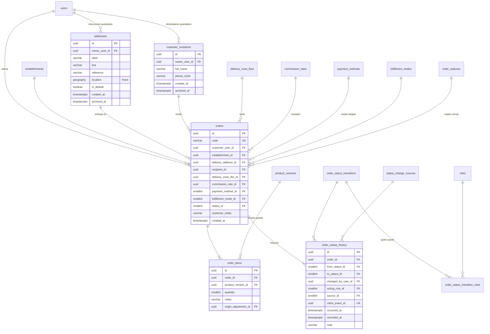

# E04 · Pedido del cliente

Historias: H04.1 a H04.4 y la línea de tiempo de H09.1. Módulo de la API: `orders`.

El pedido es la entidad con más relaciones del sistema, así que es donde más importa que guarde **solo lo que es suyo**: quién pide, dónde se compra, a dónde se entrega, para quién, con qué tarifa, con qué comisión, cómo dice que pagará y su estado. Totales, comisión en pesos, domiciliario, hora estimada, retraso y entrega se obtienen de otras tablas.

## Diagrama



## Tablas

### `addresses`

Direcciones guardadas del cliente (H04.2, RF-21). La ubicación es la actual o un punto elegido en el mapa.

| Columna | Tipo | Nulo | Regla |
| --- | --- | --- | --- |
| `owner_user_id` | FK `users` | no | `UNIQUE (id, owner_user_id)` para la llave compuesta del pedido |
| `label` | `varchar(40)` | sí | "Casa", "Trabajo". Nulo = dirección de un solo uso (ubicación actual que el cliente no quiso guardar, RF-21): no aparece en su lista |
| `line` | `varchar(200)` | sí | Texto libre; nulo solo tras la anonimización |
| `reference` | `varchar(200)` | sí | "Portón verde frente al parque" |
| `location` | `geography(Point)` | no | GIST |
| `is_default` | `boolean` | no | Índice único parcial `(owner_user_id) WHERE is_default AND archived_at IS NULL` |
| `created_at` | `timestamptz` | no | |
| `archived_at` | `timestamptz` | sí | |

- `line`, `reference` y `location` son **inmutables** (disparador): editar una dirección es archivarla y crear otra. Así el pedido viejo sigue mostrando a dónde se entregó.
- El municipio de la dirección no se guarda: el pedido usa el del establecimiento y la dirección debe caer en una zona de ese municipio.
- La única modificación permitida de esas columnas es la anonimización (procedimiento `anonymize_person`, [E01](E01-identidad-y-acceso.md#solicitudes-del-titular-h015)): `line` y `reference` quedan nulas y `location` pasa al centro del municipio.

### `customer_recipients`

Cuando el pedido es para otra persona (amigo, familiar): `owner_user_id`, `full_name varchar(120)`, `phone_e164` (`CHECK` E.164; nulo solo tras la anonimización, `CHECK (phone_e164 IS NOT NULL OR archived_at IS NOT NULL)`), `created_at`, `archived_at`. `UNIQUE (id, owner_user_id)` y `UNIQUE (owner_user_id, phone_e164) WHERE archived_at IS NULL`.

Son contactos privados del cliente, no `people`: el cliente escribe un nombre y un teléfono de un tercero que no ha aceptado ninguna política, y ese dato no debe mezclarse con la identidad de una persona registrada. Si el pedido no tiene destinatario, recibe el propio cliente.

### `orders`

| Columna | Tipo | Nulo | Regla |
| --- | --- | --- | --- |
| `id` | `uuid` | no | PK |
| `code` | `varchar(12)` | no | `UNIQUE`. `RC-` + caracteres base32 sin letras ambiguas, `CHECK (code ~ '^RC-[0-9A-HJKMNP-TV-Z]{4,8}$')`. Empieza con 4; si choca se reintenta, y si los choques se vuelven frecuentes se sube el largo sin migrar |
| `customer_user_id` | FK `users` | no | Quien pide (con el rol activo `CUSTOMER`) |
| `establishment_id` | FK `establishments` | no | El establecimiento debe tener un estado con `accepts_orders` al crear (caso de uso) |
| `delivery_address_id` | | no | FK compuesta `(delivery_address_id, customer_user_id)` → `addresses (id, owner_user_id)`: solo direcciones del mismo cliente |
| `recipient_id` | | sí | FK compuesta `(recipient_id, customer_user_id)` → `customer_recipients (id, owner_user_id)` |
| `delivery_zone_fee_id` | FK `delivery_zone_fees` | no | La tarifa vigente de la zona donde cae la dirección al confirmar. Debe ser del municipio del establecimiento (disparador) |
| `commission_rate_id` | FK `commission_rates` | no | La comisión vigente del municipio al confirmar (RF-73). Mismo disparador |
| `payment_method_id` | FK `payment_methods` | no | Cómo dice el cliente que pagará (RF-22). El medio con que realmente pagó queda en la caja ([E11](E11-cajas-y-comisiones.md)) |
| `fulfillment_mode_id` | FK `fulfillment_modes` | no | `COURIER_PURCHASE` en el MVP |
| `status_id` | FK `order_statuses` | no | Estado actual (lo escribe el disparador del historial) |
| `customer_notes` | `varchar(500)` | sí | |
| `created_at` | `timestamptz` | no | Momento de la confirmación |

Índices: `(customer_user_id, created_at DESC)` para Mis pedidos, `(status_id)`, `(establishment_id, created_at)`.

**Qué ya no está en el pedido y de dónde sale ahora:**

| Antes (`Order` provisional) | Ahora |
| --- | --- |
| `courierId` | Asignación vigente en `order_assignments` ([E07](E07-asignacion.md)) |
| `deliveryZoneId` | `delivery_zone_fees.delivery_zone_id` |
| `itemsTotal` | `v_order_amounts` (suma de las líneas efectivas) |
| `purchaseTotal`, `receiptUrl` | `order_purchases` y su movimiento de caja ([E08](E08-modo-domiciliario.md)) |
| `deliveryFee` | `delivery_zone_fees.amount` |
| `commissionRate`, `commissionAmount` | `commission_rates.rate` y `v_order_amounts` |
| `estimatedReadyAt`, `prepDelayed` | `v_order_preparation` ([E08](E08-modo-domiciliario.md)) |
| `deliveryProofUrl` | `order_delivery_proofs` ([E10](E10-entrega-e-incidencias.md)) |
| `updatedAt` | El pedido no se edita: cada cambio es una fila en otra tabla |

### `order_items`

| Columna | Tipo | Nulo | Regla |
| --- | --- | --- | --- |
| `order_id` | FK `orders` | no | `UNIQUE (id, order_id)` para las llaves compuestas de [E09](E09-producto-faltante.md) |
| `product_version_id` | FK `product_versions` | no | La versión vigente al confirmar. Debe ser de un producto del establecimiento del pedido (disparador) |
| `quantity` | `smallint` | no | `CHECK (quantity BETWEEN 1 AND 99)` |
| `notes` | `varchar(200)` | sí | "Sin cebolla" |
| `origin_adjustment_id` | FK `order_item_adjustments` | sí | `UNIQUE`. Solo en la línea que reemplaza a otra por un producto faltante ([E09](E09-producto-faltante.md)) |

Nombre, precio y tiempo de preparación se leen de la versión. El carrito (H04.1) vive en el dispositivo; la base de datos solo ve el pedido confirmado.

### `fulfillment_modes` (sistema)

`COURIER_PURCHASE` (el domiciliario compra, MVP) y `MERCHANT_DIRECT` (el comercio prepara, E15; `deactivated_at` lleno hasta entonces).

## Máquina de estados del pedido

`order_statuses` (sistema) con columnas extra:

- `is_visible_to_customer`: aparece en la línea de tiempo del cliente (RF-50).
- `reveals_delivery_details`: desde aquí el domiciliario ve la dirección exacta y el teléfono de quien recibe (H01.2).
- `counts_as_delivered`: cuenta como pedido entregado (tope de cliente nuevo, comisión, métricas).
- `is_milestone`: hito del recorrido normal, en el orden de `sort_order`. La línea de tiempo del cliente muestra los hitos que faltan y la barra de avance de Mis pedidos se mide sobre ellos; los desvíos (`AWAITING_CUSTOMER`, `PENDING_REVIEW`, `DISPUTED`) aparecen solo si ocurren.

"Pedido activo" (Mis pedidos y panel) es `NOT is_terminal`; no hace falta otra columna.

| code | is_initial | is_terminal | visible al cliente | hito | revela datos | entregado |
| --- | --- | --- | --- | --- | --- | --- |
| `PENDING_ASSIGNMENT` | sí | | sí | sí | | |
| `OFFERED` | | | | | | |
| `ACCEPTED` | | | sí | sí | | |
| `AT_ESTABLISHMENT` | | | sí | sí | | |
| `AWAITING_CUSTOMER` | | | sí | | | |
| `PREPARING` | | | sí | sí | | |
| `ON_THE_WAY` | | | sí | sí | sí | |
| `ARRIVING` | | | sí | sí | sí | |
| `PENDING_REVIEW` | | | sí | | sí | |
| `DISPUTED` | | | sí | | sí | |
| `DELIVERED` | | sí | sí | sí | | sí |
| `CANCELLED` | | sí | sí | | | |

`order_status_transitions` (`from_status_id`, `to_status_id`, PK compuesta, `allows_system boolean`) y `order_status_transition_roles` (`from_status_id`, `to_status_id`, `role_id`) dicen qué cambios existen y quién puede hacerlos:

| Desde | Hacia | Quién | Cuándo |
| --- | --- | --- | --- |
| `PENDING_ASSIGNMENT` | `OFFERED` | OPERATOR, ADMIN | Envía la oferta (H07.3) |
| `PENDING_ASSIGNMENT` | `CANCELLED` | CUSTOMER, OPERATOR, ADMIN | |
| `OFFERED` | `ACCEPTED` | COURIER | Toma el pedido (H08.2) |
| `OFFERED` | `PENDING_ASSIGNMENT` | sistema | Venció la oferta o todos rechazaron (H07.4) |
| `OFFERED` | `CANCELLED` | CUSTOMER, OPERATOR, ADMIN | |
| `ACCEPTED` | `AT_ESTABLISHMENT` | sistema | Geocerca (H08.3) |
| `ACCEPTED` | `PENDING_ASSIGNMENT` | COURIER, OPERATOR, ADMIN | El domiciliario suelta el pedido o el operador reasigna |
| `ACCEPTED` | `CANCELLED` | OPERATOR, ADMIN | |
| `AT_ESTABLISHMENT` | `AWAITING_CUSTOMER` | COURIER | Reporta producto faltante (H09.2) |
| `AT_ESTABLISHMENT` | `PREPARING` | COURIER | Registra la compra (H08.4) |
| `AT_ESTABLISHMENT` | `PENDING_ASSIGNMENT` | OPERATOR, ADMIN | Reasignar (por ejemplo, el domiciliario tuvo un problema en el local) |
| `AT_ESTABLISHMENT` | `CANCELLED` | OPERATOR, ADMIN | |
| `AWAITING_CUSTOMER` | `AT_ESTABLISHMENT` | CUSTOMER, sistema | Decidió o venció el plazo (H09.3) |
| `AWAITING_CUSTOMER` | `CANCELLED` | CUSTOMER, sistema | Canceló, o se quitó el único producto |
| `PREPARING` | `ON_THE_WAY` | COURIER | Ya está listo (H08.5) |
| `ON_THE_WAY` | `ARRIVING` | sistema | Geocerca del cliente (H08.6) |
| `ON_THE_WAY`, `ARRIVING` | `DELIVERED` | CUSTOMER | Recibí mi pedido (H10.1) |
| `ON_THE_WAY`, `ARRIVING` | `DISPUTED` | CUSTOMER | No lo recibí (H10.3) |
| `ARRIVING` | `PENDING_REVIEW` | COURIER | Entrega con foto (H10.4) |
| `PENDING_REVIEW` | `DELIVERED`, `DISPUTED` | OPERATOR, ADMIN | Revisión de la foto (H10.5) |
| `DISPUTED` | `DELIVERED`, `CANCELLED` | OPERATOR, ADMIN | Resolución de la incidencia (H10.5) |

### `order_status_history`

| Columna | Tipo | Nulo | Regla |
| --- | --- | --- | --- |
| `order_id` | FK `orders` | no | Índice `(order_id, recorded_at)` |
| `from_status_id`, `to_status_id` | FK `order_statuses` | `from` sí | FK compuesta a `order_status_transitions`. `from` nulo solo en la creación |
| `changed_by_user_id` | FK `users` | sí | Nulo si la fuente es automática |
| `acting_role_id` | FK `roles` | sí | Rol activo de la sesión; el disparador verifica que esté en `order_status_transition_roles` para ese cambio |
| `source_id` | FK `status_change_sources` | no | `USER_ACTION`, `OFFLINE_SYNC`, `GEOFENCE`, `TIMER` |
| `client_event_id` | `uuid` | sí | `UNIQUE`. Lo genera la app sin señal; reenviar el mismo evento no lo duplica (RF-46). En la primera fila es el `clientRequestId` de la confirmación: reintentar el mismo pedido devuelve el que ya existe |
| `occurred_at` | `timestamptz` | no | Cuándo pasó (hora del dispositivo si llegó sin señal) |
| `recorded_at` | `timestamptz` | no | `DEFAULT clock_timestamp()` (no `now()`): dos cambios en la misma transacción quedan en orden; cuándo lo recibió el servidor |
| `note` | `varchar(300)` | sí | |

`status_change_sources` (sistema) con `is_automatic boolean` (`GEOFENCE` y `TIMER`): `CHECK` por disparador de que `changed_by_user_id` es nulo si y solo si la fuente es automática.

Esta tabla es la línea de tiempo del cliente (H09.1, filtrada por `is_visible_to_customer`), la trazabilidad del operador y la fuente de las métricas de tiempos (RF-83).

## Vistas de cálculo

| Vista | Columnas | Se calcula con |
| --- | --- | --- |
| `v_order_lines` | Línea efectiva: producto, nombre, precio unitario efectivo, cantidad, si quedó quitada | `order_items` + versión + decisiones de [E09](E09-producto-faltante.md) |
| `v_order_amounts` | `items_total`, `delivery_fee`, `customer_total`, `commission_amount` | `v_order_lines`, `delivery_zone_fees.amount`, `round(delivery_fee × commission_rates.rate, 2)` |
| `v_customer_delivered_counts` | Pedidos entregados por cliente | `orders` con estado `counts_as_delivered` |
| `v_order_customer_status` | Último estado visible al cliente y su hora | `order_status_history` filtrado por `is_visible_to_customer` (`DISTINCT ON`): con `OFFERED` el cliente sigue viendo "Buscando domiciliario" |
| `v_order_courier` | Domiciliario del pedido | La asignación vigente o, si el pedido terminó, la última ([E07](E07-asignacion.md); se crea con esa épica) |

Tope de cliente nuevo (H04.3, RF-22), sin guardar ninguna marca:

```sql
SELECT coalesce(d.delivered, 0) = 0 AS es_nuevo
FROM users u
LEFT JOIN v_customer_delivered_counts d ON d.customer_user_id = u.id
WHERE u.id = :cliente;
-- Si es nuevo, los productos de este pedido más los de sus pedidos en curso no pueden
-- superar orders.new_customer_max_cop (parámetro por municipio). El domicilio no cuenta:
-- el tope protege lo que el domiciliario compra con su dinero.
```

La cotización (`POST /orders/quote`) devuelve el tope, lo disponible y si se excede, para que la pantalla lo muestre antes de confirmar.

## Confirmar el pedido (H04.3), en una transacción

0. Si el `clientRequestId` ya creó un pedido de este cliente, devolver ese pedido (otro cliente con el mismo id recibe `REQUEST_REUSED`).
1. Verificar horario ([E03](E03-zonas-horario-configuracion.md#horario-de-operación-h032-rf-15)), establecimiento con `accepts_orders`, productos con `is_orderable` y tope de cliente nuevo.
2. Buscar la tarifa vigente de la zona donde cae la dirección y la comisión vigente del municipio.
3. Insertar `orders` con `status_id` = `PENDING_ASSIGNMENT` (el estado `is_initial`).
4. Insertar `order_items` con la versión vigente de cada producto.
5. Insertar la primera fila de `order_status_history` (`from` nulo → `PENDING_ASSIGNMENT`). Un disparador diferido verifica al confirmar la transacción que el pedido tiene al menos una línea y su primera fila de historial.

Si el código choca (`orders_code_key`), se repite la transacción con otro código; desde el tercer intento el código crece un carácter.

Errores que la pantalla resuelve sola: `PRODUCTS_UNAVAILABLE` (`details.productIds`) quita esos productos de la canasta y `PRODUCTS_CHANGED` (`details.changes`: producto, versión y precio nuevos) los actualiza, para que el cliente revise el total antes de volver a confirmar. Sin comisión vigente en el municipio la API responde `ORDERS_NOT_CONFIGURED`: el administrador debe configurarla en el panel antes de abrir pedidos.

## Libreta del cliente (H04.2)

- La referencia es obligatoria al confirmar un punto nuevo; para cotizar basta el punto.
- Guardar con un nombre que ya existe ("Casa") archiva la anterior y crea la nueva: el pedido viejo sigue apuntando a la suya.
- El primer lugar con nombre queda como predeterminado; hasta 10 lugares guardados (`TOO_MANY_ADDRESSES`).
- El destinatario nuevo se guarda por teléfono: volver a escribir el mismo número reutiliza el contacto.

## Pendiente para otras épicas

- Cancelación por el cliente: necesita el motivo (`order_cancellations`), llega con [E10](E10-entrega-e-incidencias.md).
- `v_order_courier`: con [E07](E07-asignacion.md). `origin_adjustment_id` de las líneas: con [E09](E09-producto-faltante.md).
