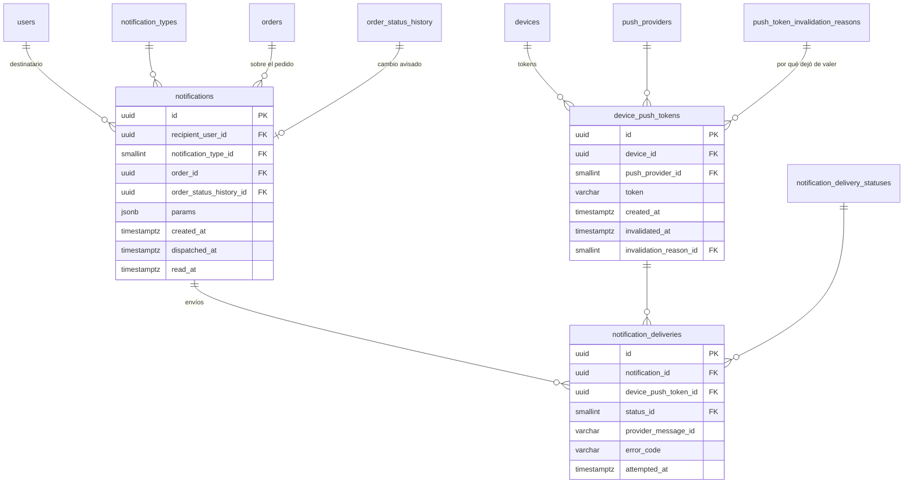

# E06 · Notificaciones push

Historias: H06.1, H06.2. Módulo de la API: `notifications`.

Se separan tres cosas que el esquema provisional juntaba en `DeviceToken`: el **dispositivo** ([E01](E01-identidad-y-acceso.md#otp-intentos-y-sesiones)), el **token push** de ese dispositivo (que el proveedor rota) y la **notificación** con sus intentos de envío.

## Diagrama



## Tablas

| Tabla | Columna | Regla |
| --- | --- | --- |
| `push_providers` (sistema) | `code` | `FCM` (Android con Google, iOS, web), `HMS` (Huawei Push Kit) |
| `device_push_tokens` | `device_id` | FK `devices` |
| | `push_provider_id` | FK |
| | `token` | `varchar(512)`, al menos 16 caracteres. Único **entre los vigentes** (índice parcial `WHERE invalidated_at IS NULL`): el mismo token puede volver tras invalidarse sin perder el historial de envíos |
| | `invalidated_at` | Se llena cuando el proveedor responde que el token ya no existe, la app envía uno nuevo o se cierra la sesión. Un token vigente por dispositivo y proveedor: índice único parcial `(device_id, push_provider_id) WHERE invalidated_at IS NULL` |
| | `invalidation_reason_id` | FK `push_token_invalidation_reasons`; se llena junto con `invalidated_at` (CHECK: los dos o ninguno). La fila es inmutable salvo esa única invalidación |
| `push_token_invalidation_reasons` (sistema) | `code` | `REPLACED` (la app registró otro token), `SIGNED_OUT` (cerró sesión en ese teléfono), `REJECTED_BY_PROVIDER` (FCM/HMS dijo que ya no existe) |
| `notification_types` (sistema) | `code` | `ORDER_OFFERED`, `OFFER_WITHDRAWN`, `ORDER_STATUS_CHANGED`, `PREPARATION_TIME_REACHED`, `ADJUSTMENT_REQUESTED`, `ADJUSTMENT_RESOLVED`, `TRIP_CANCELLED` (E09: al domiciliario, cuando el cliente cancela o no queda nada que comprar), `INCIDENT_OPENED`, `INCIDENT_RESOLVED`, `DELIVERY_PROOF_PENDING`. Columna extra `is_high_priority boolean` (sonido y prioridad alta en el proveedor) |
| `notifications` | `recipient_user_id` | FK `users` |
| | `notification_type_id` | FK |
| | `order_id` | FK `orders`, nulo si no es de un pedido |
| | `order_status_history_id` | FK `order_status_history`, nulo. En `ORDER_STATUS_CHANGED` apunta al cambio que se avisa: el estado nuevo se lee de ahí |
| | `params` | `jsonb` nulo: solo valores de la plantilla que **no** se pueden leer de otra tabla (por ejemplo, minutos de retraso calculados en el momento). El código del pedido se lee por `order_id` y el estado por `order_status_history_id`. El texto lo arma la app con su archivo de idioma y el tipo |
| | `dispatched_at` | Cuándo el despachador terminó con ella (enviada, sin destinatarios o vencida). Nula = pendiente: es la cola (outbox) |
| | `read_at` | Cuándo la abrió. `dispatched_at` y `read_at` se llenan una sola vez; el resto de la fila es inmutable (trigger) |
| `order_statuses` (E04) | `notifies_customer` | Columna nueva: el cambio a ese estado se le avisa al cliente. `true` en `ACCEPTED`, `AT_ESTABLISHMENT`, `ON_THE_WAY`, `ARRIVING`, `DELIVERED` y `CANCELLED` |
| `notification_delivery_statuses` (sistema) | `code` | `QUEUED` (inicial), `SENT`, `FAILED` |
| `notification_deliveries` | | Una fila por intento de envío a un token; un reintento tras un fallo es una fila nueva. El estado de cada intento es un solo paso (en cola → enviado o fallido, lo vigila un trigger), así que no lleva historial; `attempted_at` y `error_code` bastan |

## Cómo nace y sale un aviso

1. **Nace en la misma transacción que el cambio de estado.** Un trigger `AFTER INSERT` en `order_status_history` crea la fila de `notifications` (`ORDER_STATUS_CHANGED`) cuando el estado nuevo tiene `notifies_customer` y quien lo cambió no es el propio cliente. Ningún caso de uso puede olvidar avisar, y si la transacción se deshace el aviso desaparece con ella.
2. **Sale por el despachador (outbox).** Reclama lotes de pendientes con `FOR UPDATE SKIP LOCKED` (varias instancias de la API no envían dos veces), arma el texto en el idioma del cliente (`users.language` → `api/src/i18n/*.json`), envía por el puerto `PushGateway` (FCM o Huawei Push Kit) y registra un intento por token. Los tokens que el proveedor rechaza se invalidan con `REJECTED_BY_PROVIDER`; los fallos pasajeros se reintentan con espera y los avisos de más de 30 minutos se dan por vencidos.
3. **Cuándo corre.** Quien cambia un estado llama `Notifier.kick()` y el aviso sale al instante; además hay un barrido cada 5 s mientras hay pedidos activos y cada 10 min si no (así Neon puede dormirse).
4. **En la app** el texto de la bandeja (`/me/notifications`) lo arma la app con su archivo de idioma a partir del tipo y el estado; el push trae `type`, `notificationId`, `orderCode` y `status` para abrir el pedido al tocarlo.

- **¿A qué dispositivos se envía?** A los tokens vigentes de los dispositivos con una sesión abierta del destinatario. Ese vínculo no se guarda: se obtiene por `sessions`. Así, al cerrar sesión en un teléfono deja de recibir avisos sin borrar nada.
- **`params` en `jsonb`** es la única columna semiestructurada del diseño (junto con `audit_logs.changes`): son argumentos de una plantilla que no existen en ninguna otra tabla, no datos que se consulten ni se relacionen. Nunca se guarda ahí el texto final ni datos que ya estén en otra tabla.

Destinatarios de una notificación:

```sql
SELECT DISTINCT t.id, t.token, p.code AS proveedor  -- un dispositivo puede tener varias sesiones
FROM sessions s
JOIN device_push_tokens t ON t.device_id = s.device_id AND t.invalidated_at IS NULL
JOIN push_providers p ON p.id = t.push_provider_id
WHERE s.user_id = :destinatario AND s.ended_at IS NULL
  AND EXISTS (SELECT 1 FROM refresh_tokens r            -- sesión que todavía se puede renovar
              WHERE r.session_id = s.id AND r.consumed_at IS NULL AND r.expires_at > now());
```
