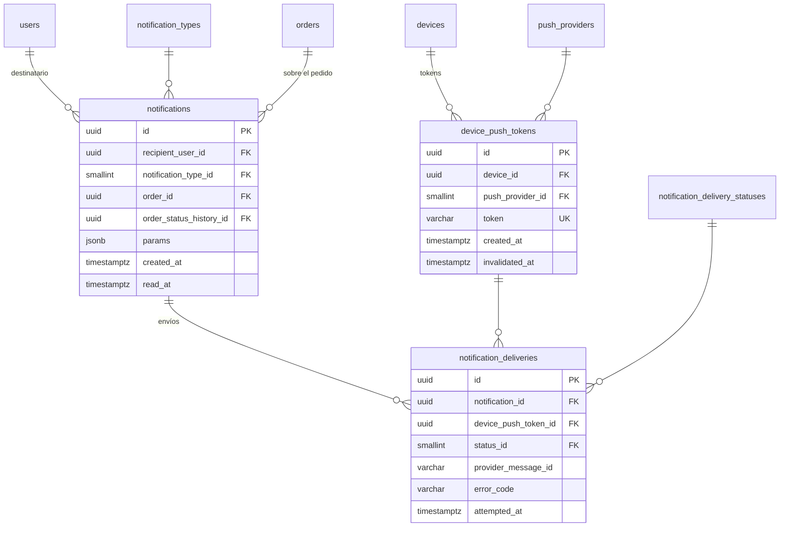

# E06 · Notificaciones push

Historias: H06.1, H06.2. Módulo de la API: `notifications`.

Se separan tres cosas que el esquema provisional juntaba en `DeviceToken`: el **dispositivo** ([E01](E01-identidad-y-acceso.md#otp-intentos-y-sesiones)), el **token push** de ese dispositivo (que el proveedor rota) y la **notificación** con sus intentos de envío.

## Diagrama



## Tablas

| Tabla | Columna | Regla |
| --- | --- | --- |
| `push_providers` (sistema) | `code` | `FCM` (Android con Google, iOS, web), `HMS` (Huawei Push Kit) |
| `device_push_tokens` | `device_id` | FK `devices` |
| | `push_provider_id` | FK |
| | `token` | `varchar(512)`, `UNIQUE` |
| | `invalidated_at` | Se llena cuando el proveedor responde que el token ya no existe o la app envía uno nuevo. Un token vigente por dispositivo y proveedor: índice único parcial `(device_id, push_provider_id) WHERE invalidated_at IS NULL` |
| `notification_types` (sistema) | `code` | `ORDER_OFFERED`, `OFFER_WITHDRAWN`, `ORDER_STATUS_CHANGED`, `PREPARATION_TIME_REACHED`, `ADJUSTMENT_REQUESTED`, `ADJUSTMENT_RESOLVED`, `INCIDENT_OPENED`, `INCIDENT_RESOLVED`, `DELIVERY_PROOF_PENDING`. Columna extra `is_high_priority boolean` (sonido y prioridad alta en el proveedor) |
| `notifications` | `recipient_user_id` | FK `users` |
| | `notification_type_id` | FK |
| | `order_id` | FK `orders`, nulo si no es de un pedido |
| | `order_status_history_id` | FK `order_status_history`, nulo. En `ORDER_STATUS_CHANGED` apunta al cambio que se avisa: el estado nuevo se lee de ahí |
| | `params` | `jsonb` nulo: solo valores de la plantilla que **no** se pueden leer de otra tabla (por ejemplo, minutos de retraso calculados en el momento). El código del pedido se lee por `order_id` y el estado por `order_status_history_id`. El texto lo arma la app con su archivo de idioma y el tipo |
| | `read_at` | Cuándo la abrió |
| `notification_delivery_statuses` (sistema) | `code` | `QUEUED` (inicial), `SENT`, `FAILED` |
| `notification_deliveries` | | Una fila por intento de envío a un token; un reintento tras un fallo es una fila nueva. El estado de cada intento es un solo paso (en cola → enviado o fallido), así que no lleva historial; `attempted_at` y `error_code` bastan |

- **¿A qué dispositivos se envía?** A los tokens vigentes de los dispositivos con una sesión abierta del destinatario. Ese vínculo no se guarda: se obtiene por `sessions`. Así, al cerrar sesión en un teléfono deja de recibir avisos sin borrar nada.
- **`params` en `jsonb`** es la única columna semiestructurada del diseño (junto con `audit_logs.changes`): son argumentos de una plantilla que no existen en ninguna otra tabla, no datos que se consulten ni se relacionen. Nunca se guarda ahí el texto final ni datos que ya estén en otra tabla.

Destinatarios de una notificación:

```sql
SELECT DISTINCT t.id, t.token, p.code AS proveedor  -- un dispositivo puede tener varias sesiones
FROM sessions s
JOIN device_push_tokens t ON t.device_id = s.device_id AND t.invalidated_at IS NULL
JOIN push_providers p ON p.id = t.push_provider_id
WHERE s.user_id = :destinatario AND s.ended_at IS NULL;
```
