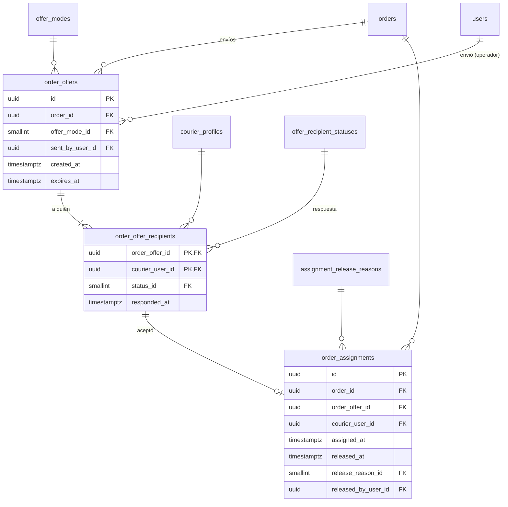

# E07 · Asignación de pedidos por el operador

Historias: H07.1 a H07.5. Módulo de la API: `dispatch`.

El esquema provisional guardaba en cada `OrderOffer` el modo y quién la envió, repetidos por cada domiciliario de un envío "a todos". Aquí se separa la **oferta** (un envío del operador) de sus **destinatarios** (cada domiciliario y su respuesta) y de la **asignación** (quién quedó con el pedido).

## Diagrama



## Tablas

### `order_offers` (H07.3, RF-32)

| Columna | Tipo | Nulo | Regla |
| --- | --- | --- | --- |
| `order_id` | FK `orders` | no | Índice `(order_id, created_at)` |
| `offer_mode_id` | FK `offer_modes` | no | `SPECIFIC` (un domiciliario elegido), `BROADCAST` (todos los disponibles) |
| `sent_by_user_id` | FK `users` | sí | Operador o administrador. Nulo solo cuando la asignación automática de E15 la envía |
| `created_at` | `timestamptz` | no | |
| `expires_at` | `timestamptz` | no | `created_at + offers.timeout_seconds` ([excepción](README.md#excepciones-deliberadas)). `CHECK (expires_at > created_at)` |

`offer_modes` (sistema) con `max_recipients smallint` nulo (1 para `SPECIFIC`): un disparador impide más destinatarios de los permitidos (bloquea la fila de `orders` para que dos inserciones no lo pasen a la vez).

### `order_offer_recipients`

PK `(order_offer_id, courier_user_id)`. `courier_user_id` es FK a `courier_profiles (user_id)`, así que solo se puede ofrecer a domiciliarios.

`offer_recipient_statuses` (sistema):

| code | is_initial | is_terminal | Uso |
| --- | --- | --- | --- |
| `PENDING` | sí | | Esperando respuesta |
| `ACCEPTED` | | sí | Tomó el pedido |
| `REJECTED` | | sí | "No puedo" |
| `EXPIRED` | | sí | Venció sin responder |
| `WITHDRAWN` | | sí | Otro lo tomó primero o el operador canceló |

Las respuestas son un solo paso (`PENDING` → final) con su hora en `responded_at`, así que no llevan tabla de historial: la fila misma es el historial. Un disparador impide cambiar una respuesta final.

### `order_assignments`

Quién tiene el pedido. Puede haber varias por pedido si se reasigna, pero **una sola vigente**.

| Columna | Tipo | Nulo | Regla |
| --- | --- | --- | --- |
| `order_id` | FK `orders` | no | Índice único parcial `(order_id) WHERE released_at IS NULL`: **garantiza que el primero que acepta gana** |
| `order_offer_id`, `courier_user_id` | | no | FK compuesta → `order_offer_recipients`: solo se asigna a quien recibió la oferta. `UNIQUE (order_offer_id, courier_user_id)` |
| `assigned_at` | `timestamptz` | no | |
| `released_at` | `timestamptz` | sí | |
| `release_reason_id` | FK `assignment_release_reasons` | sí | `COURIER_RELEASED`, `OPERATOR_REASSIGNED`, `ORDER_CANCELLED`, `ORDER_COMPLETED`. `CHECK ((released_at IS NULL) = (release_reason_id IS NULL))` |
| `released_by_user_id` | FK `users` | sí | |

La oferta debe pertenecer al mismo pedido: FK compuesta `(order_offer_id, order_id)` → `order_offers (id, order_id)` (con `UNIQUE (id, order_id)` en `order_offers`).

**Vida de una asignación.** Se libera siempre que el domiciliario deja de tener el pedido: si lo suelta, si lo reasignan, si se cancela y también cuando el pedido llega a un estado terminal (`ORDER_COMPLETED`, en la misma transacción que la fila `→ DELIVERED`). Así:

- **Domiciliario ocupado** = tiene una asignación vigente ([E08](E08-modo-domiciliario.md#disponibilidad-h081-rf-40)).
- **Domiciliario del pedido** = la asignación vigente o, en un pedido terminado, la última (`v_order_courier`).
- Un disparador diferido impide que un pedido en `PENDING_ASSIGNMENT` u `OFFERED` tenga una asignación vigente, o que un pedido entre `ACCEPTED` y `DISPUTED` no tenga ninguna.

## Aceptar una oferta (H08.2), en una transacción

1. Marcar la respuesta, solo si sigue pendiente y no venció:

   ```sql
   UPDATE order_offer_recipients r
   SET status_id = :accepted, responded_at = now()
   FROM order_offers o
   WHERE o.id = r.order_offer_id
     AND r.order_offer_id = :oferta AND r.courier_user_id = :domiciliario
     AND r.status_id = :pending AND now() < o.expires_at;
   -- 0 filas: la oferta venció o ya fue retirada.
   ```
2. `INSERT INTO order_assignments`. Si otro domiciliario ya aceptó, el índice único parcial lo rechaza y la transacción se revierte: la app muestra "otro domiciliario tomó el pedido".
3. Historial del pedido `OFFERED → ACCEPTED`.
4. Los demás destinatarios `PENDING` pasan a `WITHDRAWN` y reciben `OFFER_WITHDRAWN`.

## Vencimiento (H07.4)

Un trabajo periódico marca `EXPIRED` a los destinatarios `PENDING` de ofertas vencidas y, si el pedido sigue en `OFFERED` sin asignación vigente, inserta en el historial `OFFERED → PENDING_ASSIGNMENT` con fuente `TIMER`. El panel resalta los pedidos cuyo último cambio fue ese.

## Domiciliarios cercanos (H07.2, RF-31)

Todos los disponibles, verificados y libres, ordenados por cercanía al local (el mapa los muestra todos):

```sql
SELECT c.user_id, ST_Distance(l.location, e.location) AS distancia
FROM v_dispatchable_couriers c
JOIN v_open_availability a ON a.courier_user_id = c.user_id      -- E08
JOIN v_courier_last_location l ON l.courier_user_id = c.user_id  -- E08
JOIN establishments e ON e.id = :establecimiento
WHERE l.recorded_at > now() - interval '2 minutes'
  AND NOT EXISTS (SELECT 1 FROM order_assignments x
                  WHERE x.courier_user_id = c.user_id AND x.released_at IS NULL)
ORDER BY distancia;
```

## Auditoría del personal (H07.5, RNF-07)

Quién asignó, reasignó o canceló ya está en `order_offers.sent_by_user_id`, `order_assignments.released_by_user_id` y `order_status_history.changed_by_user_id`. La pantalla de auditoría une esas tablas con `audit_logs` ([00](00-transversal.md#auditoría)) para lo que no tiene tabla propia.
