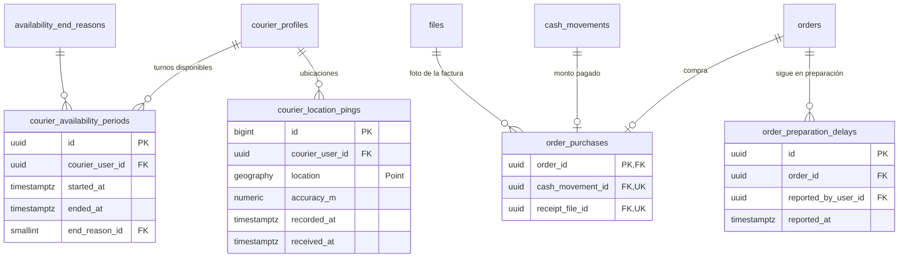

# E08 · Modo domiciliario y geocercas

Historias: H08.1 a H08.8. Módulos de la API: `dispatch` (disponibilidad y ubicación) y `orders` (compra y preparación).

El esquema provisional guardaba en `CourierProfile` tres datos que cambian a cada rato (`isAvailable`, `lastLocation`, `lastSeenAt`). Aquí cada uno sale de su propia tabla de hechos, y el perfil queda solo con lo que describe al domiciliario.

## Diagrama



## Disponibilidad (H08.1, RF-40)

`courier_availability_periods`: cada vez que el domiciliario se marca **Disponible** se abre un periodo; al desactivarse se cierra.

| Columna | Tipo | Nulo | Regla |
| --- | --- | --- | --- |
| `courier_user_id` | FK `courier_profiles` | no | Índice único parcial `(courier_user_id) WHERE ended_at IS NULL`: un solo periodo abierto |
| `started_at` | `timestamptz` | no | |
| `ended_at` | `timestamptz` | sí | `CHECK (ended_at > started_at)` |
| `end_reason_id` | FK `availability_end_reasons` | sí | `TOGGLED_OFF`, `INACTIVITY_TIMEOUT`, `ACCOUNT_DISABLED`. `CHECK ((ended_at IS NULL) = (end_reason_id IS NULL))` |

- **Disponible** = tiene un periodo abierto (`v_open_availability`). **Ocupado** = tiene una asignación vigente ([E07](E07-asignacion.md)). Ninguno de los dos se guarda como booleano.
- Abrir un periodo exige haber aceptado la versión vigente de `COURIER_LOCATION_AUTHORIZATION` ([E01](E01-identidad-y-acceso.md#consentimientos-ley-1581-rf-07)).
- Las horas trabajadas por día salen de esta tabla (métricas y, más adelante, pagos por turno).

## Ubicación (H08.1, RNF-06)

`courier_location_pings`: una fila por lectura que envía la app, solo mientras hay un periodo abierto o una asignación vigente (regla del caso de uso).

| Columna | Tipo | Nulo | Regla |
| --- | --- | --- | --- |
| `id` | `bigint` identity | no | PK (tabla de mucho volumen) |
| `courier_user_id` | FK `courier_profiles` | no | Índice `(courier_user_id, recorded_at DESC)` |
| `location` | `geography(Point)` | no | |
| `accuracy_m` | `numeric(6,1)` | sí | Las lecturas con precisión peor que 50 m no cuentan para geocercas |
| `recorded_at` | `timestamptz` | no | Hora del GPS (puede llegar tarde sin señal) |
| `received_at` | `timestamptz` | no | `DEFAULT now()` |

- **Retención de 30 días** (`location.retention_days`): índice en `received_at` y un trabajo diario `DELETE FROM courier_location_pings WHERE received_at < now() - interval '30 days'`. Con el volumen del piloto basta una tabla normal; si el volumen crece se particiona **por día** con PK `(id, received_at)` (PostgreSQL exige la llave de partición en la PK) y se borran particiones. Prisma Migrate no maneja particiones, así que ese cambio se haría en SQL.
- **Última ubicación** = `v_courier_last_location` (`DISTINCT ON (courier_user_id) ... ORDER BY recorded_at DESC`). No se guarda en el perfil. Si más adelante hace falta por volumen, se mantiene en Redis (E13), no en otra tabla.
- **Nunca** se expone al cliente: ninguna vista del cliente une esta tabla.

## Geocercas (H08.3, H08.6, RF-42, RF-43)

No hay tabla de "eventos de geocerca": la llegada es un **cambio de estado** con fuente `GEOFENCE` en `order_status_history`, y las lecturas que lo justificaron están en `courier_location_pings`.

Llegada al local con N lecturas seguidas dentro del área, todas posteriores a la aceptación y recientes:

```sql
SELECT count(*) = :lecturas AND bool_and(ST_Covers(e.area, p.location)) AS llego
FROM (
  SELECT location FROM courier_location_pings
  WHERE courier_user_id = :domiciliario
    AND accuracy_m <= 50
    AND recorded_at >= :aceptado_en              -- occurred_at de la fila → ACCEPTED
    AND recorded_at > now() - interval '2 minutes'
  ORDER BY recorded_at DESC
  LIMIT :lecturas                                -- geofence.consecutive_readings
) p
CROSS JOIN establishments e
WHERE e.id = :establecimiento
GROUP BY e.id;
```

Con menos lecturas de las exigidas, `count(*) = :lecturas` es falso: una sola lectura nunca basta.

Llegando donde el cliente:

```sql
SELECT ST_DWithin(:posicion, a.location, :metros)   -- delivery.arriving_meters
FROM orders o JOIN addresses a ON a.id = o.delivery_address_id
WHERE o.id = :pedido;
```

## Compra en el local (H08.4, RF-44)

`order_purchases` (1:1 con el pedido):

| Columna | Tipo | Nulo | Regla |
| --- | --- | --- | --- |
| `order_id` | FK `orders` | no | PK |
| `cash_movement_id` | FK `cash_movements` | no | `UNIQUE`. El movimiento `PURCHASE` de la caja del domiciliario **es** el monto pagado en el local ([E11](E11-cajas-y-comisiones.md)); aquí no se repite el monto |
| `receipt_file_id` | FK `files` | no | `UNIQUE`. Propósito `PURCHASE_RECEIPT` |

FK compuesta `(cash_movement_id, order_id)` → `cash_movements (id, order_id)` (con `UNIQUE (id, order_id)` en `cash_movements`): el movimiento es del mismo pedido. Que sea de tipo `PURCHASE` lo verifica un disparador.

Quién y cuándo registró la compra **no** se repiten aquí: quién es `cash_movements.created_by_user_id` y `files.uploaded_by_user_id`; cuándo empezó la preparación es el `occurred_at` de la fila `AT_ESTABLISHMENT → PREPARING` del historial. En la misma transacción se insertan el movimiento `PURCHASE`, `order_purchases` y esa fila del historial.

## Preparación (H08.5, RF-45)

- **Hora estimada de listo** = `occurred_at` de la fila `→ PREPARING` + `max(prep_minutes)` de las líneas efectivas del pedido. Se calcula en `v_order_preparation`; no se guarda.
- **"Ya está listo"** es el cambio de estado `PREPARING → ON_THE_WAY`; no necesita otra tabla.
- **"Sigue en preparación"** es una fila en `order_preparation_delays` (`order_id`, `reported_by_user_id`, `reported_at`). "Retrasado" = existe al menos una fila; el siguiente aviso se programa desde la última (`preparation.recheck_seconds`, [E03](E03-zonas-horario-configuracion.md#parámetros-del-negocio-h033-rf-16)).

`v_order_preparation`: `order_id`, `started_at`, `estimated_ready_at`, `delay_count`, `is_delayed`, `next_check_at`. Alimenta la cuenta regresiva del cliente (H09.1) y la alerta "preparación retrasada" del panel.

## Modo cliente (H08.7)

No crea tablas: es `sessions.active_role_id = CUSTOMER` ([E01](E01-identidad-y-acceso.md#roles-y-permisos)). Al cambiar a modo cliente se cierra el periodo de disponibilidad abierto (`TOGGLED_OFF`).

## Trabajar sin señal (H08.8, RF-46)

- Cada cambio de estado hecho sin señal llega con `client_event_id` (UUID generado en la app) y `occurred_at` (hora del teléfono) y se guarda con fuente `OFFLINE_SYNC`. Reenviar el mismo evento choca con el `UNIQUE` y se responde como ya recibido.
- Las ubicaciones guardadas sin señal llegan con su `recorded_at` real; las geocercas solo evalúan lecturas recientes, así que una lectura vieja no dispara llegadas.
