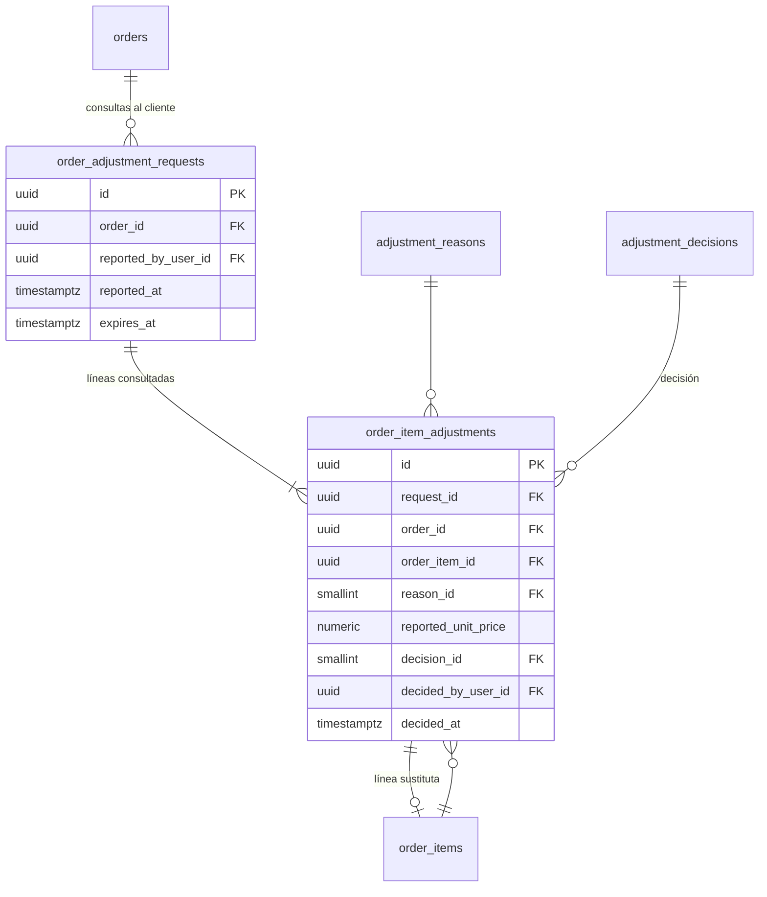

# E09 · Seguimiento del pedido y producto faltante

Historias: H09.1 (línea de tiempo, ver [E04](E04-pedido-del-cliente.md#order_status_history) y [E08](E08-modo-domiciliario.md#preparación-h085-rf-45)), H09.2 y H09.3. Módulo de la API: `fulfillment` (el del pedido en curso del domiciliario, E08); el detalle del cliente (`orders`) lee las consultas con el mismo lector.

El "chat estratégico" no es un chat libre. Es una **consulta** del domiciliario al cliente, que puede incluir **varias líneas** del pedido a la vez (falta la gaseosa y la hamburguesa cambió de precio), con un plazo común, y una **decisión** del cliente por cada línea con opciones cerradas.

## Diagrama



## Tablas

### `order_adjustment_requests` (H09.2, RF-51)

Una consulta del domiciliario. Es la que mueve el pedido a `AWAITING_CUSTOMER` y la que tiene el plazo.

| Columna | Tipo | Nulo | Regla |
| --- | --- | --- | --- |
| `order_id` | FK `orders` | no | `UNIQUE (id, order_id)` para la llave compuesta de las líneas |
| `reported_by_user_id` | FK `users` | no | El domiciliario asignado |
| `reported_at` | `timestamptz` | no | |
| `expires_at` | `timestamptz` | no | `reported_at + adjustments.timeout_seconds` (180 s) |

Una sola consulta abierta por pedido: mientras el pedido esté en `AWAITING_CUSTOMER` no se crea otra (el estado lo impide, porque no existe la transición `AWAITING_CUSTOMER → AWAITING_CUSTOMER`, y un disparador lo repite: quien reporta es el domiciliario asignado, el pedido está en `AWAITING_CUSTOMER` y no hay otra consulta con líneas pendientes). El domiciliario marca **todas** las líneas con problema en un solo envío; la consulta no admite líneas nuevas después de creada (una pregunta que cambia mientras el cliente la lee confunde y reinicia la cuenta). Si aparece otro faltante, abre una consulta nueva cuando el pedido vuelva a `AT_ESTABLISHMENT`.

`expires_at` lo fija la base con `clock_timestamp()` y el ajuste `adjustments.timeout_seconds` del municipio (180 s por defecto), no el reloj del teléfono.

### `order_item_adjustments` (H09.2, H09.3)

Una fila por línea consultada, con su decisión en la misma fila.

| Columna | Tipo | Nulo | Regla |
| --- | --- | --- | --- |
| `request_id` | | no | FK compuesta `(request_id, order_id)` → `order_adjustment_requests (id, order_id)` |
| `order_id` | | no | FK compuesta `(order_item_id, order_id)` → `order_items (id, order_id)` (con `UNIQUE (id, order_id)` en `order_items`): la línea es del mismo pedido que la consulta. Es la única razón de esta columna ([excepción](README.md#excepciones-deliberadas) del mismo tipo que `order_assignments.order_id`) |
| `order_item_id` | | no | Índice único parcial `(order_item_id) WHERE decided_at IS NULL`: una sola consulta pendiente por línea, garantizada por un índice nativo |
| `reason_id` | FK `adjustment_reasons` | no | |
| `reported_unit_price` | `numeric(12,2)` | sí | Obligatorio si el motivo `requires_price` (disparador), `CHECK (reported_unit_price > 0)` |
| `decision_id` | FK `adjustment_decisions` | sí | Nulo = pendiente |
| `decided_by_user_id` | FK `users` | sí | El cliente; nulo si decidió el sistema por vencimiento |
| `decided_at` | `timestamptz` | sí | `CHECK ((decision_id IS NULL) = (decided_at IS NULL))` |

La decisión vive en la misma fila porque es la respuesta a esa pregunta y ocurre una sola vez: se llena con un `UPDATE ... WHERE decided_at IS NULL` (que también resuelve la carrera entre el cliente y el vencimiento) y después un disparador impide cambiarla.

`adjustment_reasons` (sistema), columna `requires_price boolean`: `UNAVAILABLE` (no), `PRICE_CHANGED` (sí).

`adjustment_decisions` (sistema) con columnas `removes_item`, `uses_reported_price`, `creates_substitute`, `cancels_order`, `is_automatic` (todas `boolean`):

| code | quita la línea | usa precio nuevo | crea sustituta | cancela | automática |
| --- | --- | --- | --- | --- | --- |
| `SUBSTITUTE` | sí | | sí | | |
| `REMOVE_ITEM` | sí | | | | |
| `ACCEPT_PRICE` | | sí | | | |
| `CANCEL_ORDER` | | | | sí | |
| `EXPIRED_REMOVED` | sí | | | | sí |

- `decided_by_user_id` es nulo si y solo si la decisión `is_automatic` (disparador).
- **Sustitución:** se inserta una línea nueva en `order_items` con `origin_adjustment_id` = esta fila y la versión vigente del producto elegido. Un disparador verifica que la línea sustituta sea del mismo pedido y que la decisión `creates_substitute`.
- **Vencimiento:** el mismo reloj de la preparación (`PreparationClock`) duerme hasta el próximo `expires_at`, y en una transacción por pedido (`FOR UPDATE SKIP LOCKED`) llena `EXPIRED_REMOVED` en las líneas pendientes y saca el pedido de `AWAITING_CUSTOMER` con fuente `TIMER`.
- **Cancelar todo** (`CANCEL_ORDER`) responde por la consulta entera: llena todas sus líneas pendientes con esa decisión.
- `ACCEPT_PRICE` solo es opción de una línea `PRICE_CHANGED` (disparador); las opciones que ve el cliente salen del catálogo y del motivo, no de una lista en el código de las pantallas.

## Volver a la compra

El pedido sale de `AWAITING_CUSTOMER` solo cuando **todas** las líneas de la consulta tienen decisión:

- Si alguna es `CANCEL_ORDER`, o el pedido se quedó sin líneas efectivas: `AWAITING_CUSTOMER → CANCELLED` con motivo `CUSTOMER_REQUEST` o `ALL_ITEMS_UNAVAILABLE` en `order_cancellations` ([E10](E10-entrega-e-incidencias.md#cancelaciones); las dos tablas de cancelación se crean en esta migración porque E09 es el primero que cancela). La asignación del domiciliario se libera (`ORDER_CANCELLED`) y él recibe `TRIP_CANCELLED`.
- Si no: `AWAITING_CUSTOMER → AT_ESTABLISHMENT`.

En los dos casos el domiciliario recibe `ADJUSTMENT_RESOLVED` (o `TRIP_CANCELLED`) y el cliente, el cambio de estado normal. Lo hace el caso de uso que registra la última decisión, y un disparador diferido sobre `order_status_history` rechaza la salida de `AWAITING_CUSTOMER` si quedan líneas pendientes.

## Líneas efectivas

`v_order_lines` es la única fuente del contenido real del pedido para el total, la preparación y la pantalla del domiciliario. No lleva textos (una vista no recibe el idioma): la consulta que la usa une `product_version_texts` con respaldo a `es`.

```sql
CREATE VIEW v_order_lines AS
SELECT oi.id AS order_item_id, oi.order_id, oi.product_version_id, oi.quantity,
       CASE WHEN d.uses_reported_price THEN a.reported_unit_price ELSE pv.price END AS unit_price,
       pv.prep_minutes,
       coalesce(d.removes_item, false) AS is_removed
FROM order_items oi
JOIN product_versions pv ON pv.id = oi.product_version_id
LEFT JOIN LATERAL (
  SELECT x.reported_unit_price, x.decision_id
  FROM order_item_adjustments x
  WHERE x.order_item_id = oi.id AND x.decided_at IS NOT NULL
  ORDER BY x.decided_at DESC
  LIMIT 1
) a ON true
LEFT JOIN adjustment_decisions d ON d.id = a.decision_id;
```

Nombre en el idioma del usuario:

```sql
SELECT l.*, coalesce(t.name, t_es.name) AS name
FROM v_order_lines l
LEFT JOIN product_version_texts t    ON t.product_version_id = l.product_version_id AND t.language_id = :idioma
LEFT JOIN product_version_texts t_es ON t_es.product_version_id = l.product_version_id AND t_es.language_id = :es
WHERE l.order_id = :pedido;
```

## Flujo (H09.2 → H09.3)

1. El domiciliario reporta: `order_adjustment_requests` con sus `order_item_adjustments` + historial `AT_ESTABLISHMENT → AWAITING_CUSTOMER` + notificación `ADJUSTMENT_REQUESTED`.
2. El cliente decide línea por línea (o vence): se llena la decisión, se crea la línea sustituta si aplica y, con la última decisión, el pedido vuelve a `AT_ESTABLISHMENT` o se cancela.
3. Las decisiones alimentan la métrica de producto faltante por local (RF-83) sin tablas extra.

## API

| Quién | Ruta | Qué hace |
| --- | --- | --- |
| Domiciliario | `POST /courier/trip/:code/adjustments` | `{clientEventId, lines: [{orderItemId, reason, unitPrice?}]}` (hasta 30 líneas). No se encola sin señal: la app lo envía en línea o avisa |
| Domiciliario | `GET /courier/trip` | `adjustment`: la última consulta del local (abierta, o con lo que decidió el cliente) |
| Cliente | `GET /orders/:code` | `adjustments`: las consultas, de la más reciente a la más vieja, con `options` por línea pendiente |
| Cliente | `GET /orders/:code/adjustments/:lineId/substitutes` | Productos pedibles del mismo local, que no estén ya en el pedido; primero la misma sección del menú y el precio más cercano (`sameSection`) |
| Cliente | `POST /orders/:code/adjustments/:lineId/decision` | `{decision, productVersionId?}`. `EXPIRED_REMOVED` solo la toma el sistema |

Errores: `ADJUSTMENT_REPORT_INVALID` (con `problem`: `EMPTY`, `TOO_MANY`, `DUPLICATED`, `PRICE_REQUIRED`, `PRICE_NOT_ALLOWED`, `PRICE_INVALID`, `PRICE_UNCHANGED`), `ADJUSTMENT_LINES_INVALID`, `ADJUSTMENT_CLOSED`, `ADJUSTMENT_OPTION_INVALID`, `SUBSTITUTE_UNAVAILABLE`.

Mientras el domiciliario está en el local o esperando, la web y la app del cliente vuelven a pedir el pedido cada 4 s (y la app del domiciliario, mientras espera): el push ayuda, pero la pregunta tiene minutos y no todos los teléfonos lo reciben.
