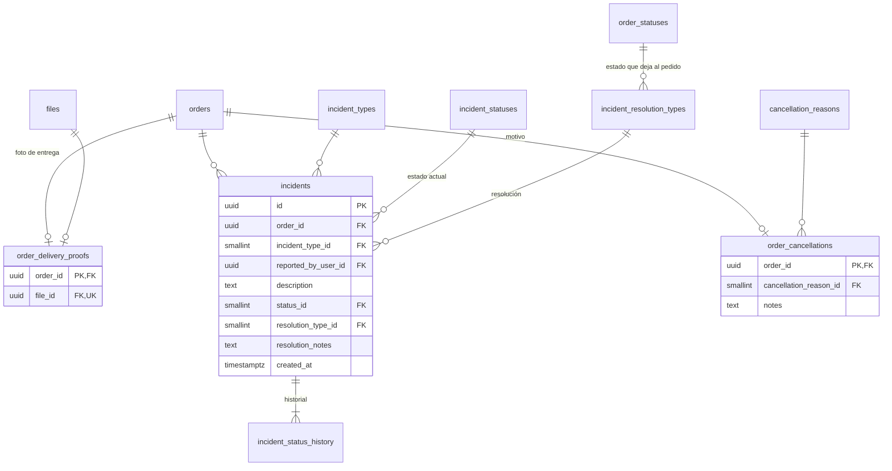

# E10 · Entrega, confirmación e incidencias

Historias: H10.1 a H10.5. El cobro contra entrega (H10.2) se registra en la caja: ver [E11](E11-cajas-y-comisiones.md#cobro-contra-entrega-h102-rf-61). Módulo de la API: `orders`.

**Quién confirmó y cuándo** ya está en `order_status_history`: la fila que lleva el pedido a `DELIVERED` dice si fue el cliente (rol activo `CUSTOMER`) o un operador al revisar la foto o resolver una incidencia. Por eso aquí no hay una tabla "entregas" que lo repita; solo se guarda lo que el historial no tiene: la foto, la incidencia con su resolución y el motivo de cancelación.

## Diagrama

## Confirmación del cliente (H10.1, RF-60)

No crea filas propias: "Recibí mi pedido" es el cambio `ARRIVING → DELIVERED` (o desde `ON_THE_WAY`) con rol activo `CUSTOMER`. La pantalla que no se cierra se muestra mientras el pedido esté en `ARRIVING` y se calcula del estado.

## Entrega con foto (H10.4, RF-63)

`order_delivery_proofs` (1:1 con el pedido):

| Columna | Tipo | Nulo | Regla |
| --- | --- | --- | --- |
| `order_id` | FK `orders` | no | PK |
| `file_id` | FK `files` | no | `UNIQUE`. Propósito `DELIVERY_PROOF` (`requires_camera`); `files.captured_at` y `captured_location` son obligatorios para este propósito (disparador) |

Quién la tomó es `files.uploaded_by_user_id` (debe ser el domiciliario asignado) y cuándo, `files.captured_at`; no se repiten. Solo se permite si pasaron `delivery.proof_after_seconds` desde que el pedido entró a `ARRIVING` (caso de uso).

En la misma transacción: la foto y el historial `ARRIVING → PENDING_REVIEW`. El operador revisa y deja el pedido en `DELIVERED` o `DISPUTED` (H10.5); su decisión es esa fila del historial, con su nota.

## Incidencias (H10.3, H10.5, RF-62)

| Tabla | Regla |
| --- | --- |
| `incident_types` (sistema) | `NOT_RECEIVED`, `WRONG_ORDER`, `DAMAGED`, `OTHER`. Columna `opens_dispute boolean`: si al reportarla el pedido pasa a `DISPUTED` (sí en `NOT_RECEIVED`; no en los reclamos sobre un pedido ya entregado) |
| `incident_statuses` (sistema) | `OPEN` (inicial), `IN_REVIEW`, `RESOLVED` (terminal). Nivel completo |
| `incident_status_transitions` | `OPEN→IN_REVIEW`, `OPEN→RESOLVED`, `IN_REVIEW→RESOLVED` |
| `incident_status_history` | Patrón estándar: quién la tomó y quién la resolvió, y cuándo |
| `incident_resolution_types` (sistema) | `RESOLVED_AS_DELIVERED`, `RESOLVED_AS_CANCELLED`, `NO_ORDER_CHANGE`. Columna `resulting_order_status_id` FK `order_statuses`, nula: a qué estado pasa el pedido (`DELIVERED`, `CANCELLED`, o ninguno en reclamos sobre pedidos ya entregados) |

`incidents`:

| Columna | Tipo | Nulo | Regla |
| --- | --- | --- | --- |
| `order_id` | FK `orders` | no | Una sola incidencia sin resolver por pedido (disparador que bloquea la fila del pedido) |
| `incident_type_id` | FK | no | |
| `reported_by_user_id` | FK `users` | no | El cliente del pedido, o un operador cuando la abre al rechazar una foto de entrega (`PENDING_REVIEW → DISPUTED`) |
| `description` | `text` | sí | |
| `status_id` | FK `incident_statuses` | no | Estado actual (disparador del historial) |
| `resolution_type_id` | FK `incident_resolution_types` | sí | Lleno si y solo si el estado es `RESOLVED` (lo verifica el disparador del historial al pasar a `RESOLVED`) |
| `resolution_notes` | `text` | sí | |
| `created_at` | `timestamptz` | no | |

La resolución va en la propia incidencia porque ocurre una sola vez; quién y cuándo resolvió están en la fila `→ RESOLVED` del historial.

Un disparador diferido sobre `order_status_history` exige que todo pedido que entra a `DISPUTED` tenga una incidencia sin resolver.

Resolver (H10.5), en una transacción: llenar `resolution_type_id` y `resolution_notes`, historial de la incidencia `→ RESOLVED`, historial del pedido `DISPUTED → resulting_order_status_id` (si no es nulo) y notificaciones `INCIDENT_RESOLVED` al cliente y al domiciliario.

## Cancelaciones

`order_cancellations` (1:1 con el pedido): `cancellation_reason_id` y `notes`. Quién y cuándo canceló están en la fila `→ CANCELLED` del historial; un disparador diferido exige que todo pedido cancelado tenga su motivo.

`cancellation_reasons` (**sistema**, porque el programa usa algunos códigos, con nombres en `cancellation_reason_translations`): `CUSTOMER_REQUEST`, `NO_COURIER_AVAILABLE`, `ESTABLISHMENT_CLOSED`, `ALL_ITEMS_UNAVAILABLE`, `CUSTOMER_UNREACHABLE`, `INCIDENT_RESOLUTION`. Columna `is_automatic boolean` para las que usa el sistema.

## Alertas del panel (H10.5, RF-64)

Ninguna alerta se guarda; todas salen de `v_active_order_alerts`:

| Alerta | Condición |
| --- | --- |
| Sin asignar | Estado `PENDING_ASSIGNMENT` |
| Nadie aceptó | Último cambio `OFFERED → PENDING_ASSIGNMENT` con fuente `TIMER` |
| Preparación retrasada | `v_order_preparation.is_delayed` |
| Decisión vencida | Decisión `EXPIRED_REMOVED` en los últimos minutos |
| Foto por revisar | Estado `PENDING_REVIEW` |
| Incidencia | Incidencia sin resolver |
| Entregado sin cobro | Pedido `counts_as_delivered` sin movimiento `COLLECTION` ([E11](E11-cajas-y-comisiones.md)) |
