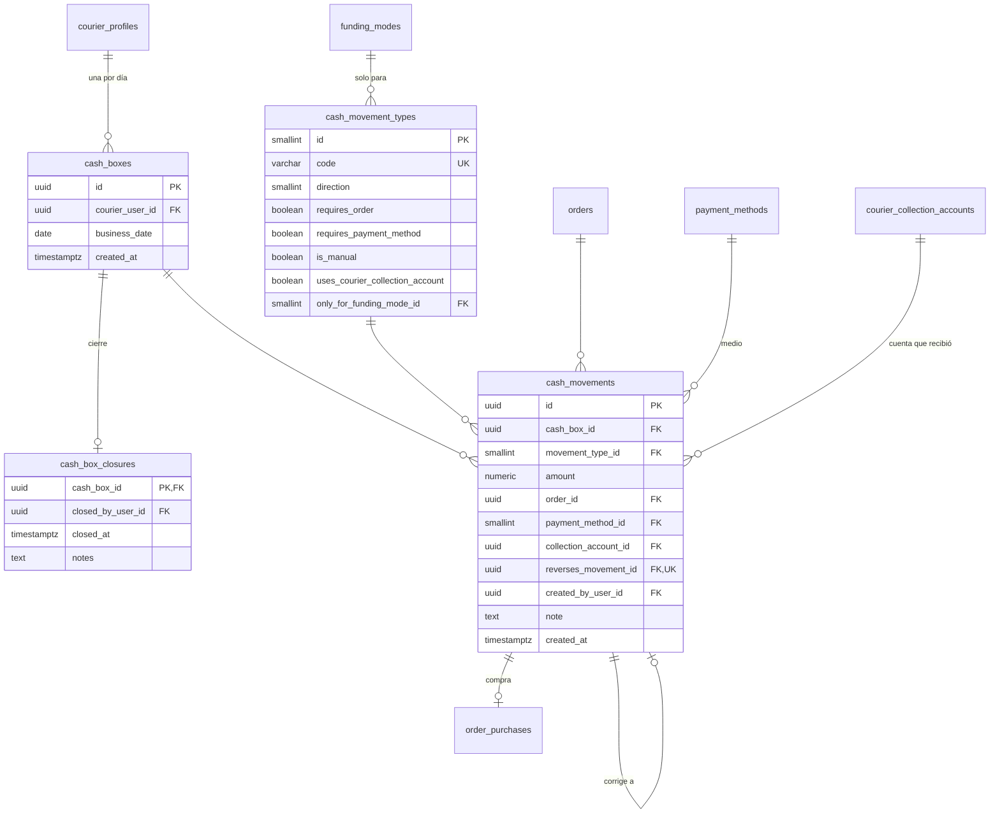

# E11 · Cajas diarias y comisiones

Historias: H11.1 a H11.4 y el cobro de H10.2. Módulo de la API: `cash`.

> Ya existen desde E08 (migración `20261025000000_courier_e08`): `cash_movement_types`, `cash_boxes` y `cash_movements`, con lo justo para la compra en el local (`PURCHASE`). La caja del día se abre sola con la primera compra del domiciliario, en el día del municipio. E11 agrega el resto de tipos, el cierre y los informes sobre esas mismas tablas.

## Idea central: un libro, nada más

Todo peso que **se mueve de verdad** (la base que entrega RapiChonta, lo que el domiciliario paga en el local, lo que le paga el cliente, lo que devuelve al final del día y las correcciones) es una fila inmutable en `cash_movements`, y **solo ahí**. La tarifa del domicilio y la comisión no son dinero que se mueve: se calculan del pedido ([E04](E04-pedido-del-cliente.md#vistas-de-cálculo)). El saldo de una caja y lo que el domiciliario debe entregar se calculan en vistas; no se guardan.

Esto reemplaza al esquema provisional, que guardaba `openingAmount` en la caja, `purchaseTotal` en el pedido y además movimientos con los mismos montos.

## Diagrama



## Tablas

### `cash_boxes` (H11.1, RF-70)

| Columna | Tipo | Nulo | Regla |
| --- | --- | --- | --- |
| `courier_user_id` | FK `courier_profiles` | no | |
| `business_date` | `date` | no | Fecha en la zona horaria del municipio del domiciliario. `UNIQUE (courier_user_id, business_date)` |
| `created_at` | `timestamptz` | no | |

En modo `CASH_BOX` la abre un administrador junto con el movimiento `OPENING` (quién la abrió es el `created_by_user_id` de ese movimiento); en modo `OWN_FUNDS` la crea el sistema con el primer pedido del día.

- El **modo de financiación** de la caja no se guarda: es el vigente en `courier_funding_modes` al inicio de `business_date` ([E01](E01-identidad-y-acceso.md#modo-de-financiación-versionado)).
- La **base entregada** no es una columna: es el movimiento `OPENING`.
- **Abierta** = no tiene fila en `cash_box_closures`. La caja tiene dos momentos (abierta y cerrada) y el cierre es un hecho con autor, fecha y notas, así que se guarda como tabla 1:1 en lugar de un catálogo de estados.

### `cash_box_closures` (H11.3, RF-72)

`cash_box_id` PK, `closed_by_user_id` (administrador), `closed_at`, `notes`. Después del cierre no se aceptan movimientos en esa caja (disparador). Un error en un día cerrado se corrige con un ajuste en la caja abierta que apunta al movimiento original.

### `cash_movement_types` (sistema)

El sentido es desde el punto de vista de **lo que el domiciliario tiene en su poder y debe responder ante RapiChonta**: `+1` aumenta lo que debe entregar, `−1` lo disminuye.

| code | direction | requires_order | requires_payment_method | is_manual | uses_courier_collection_account | only_for_funding_mode | Qué es |
| --- | --- | --- | --- | --- | --- | --- | --- |
| `OPENING` | +1 | | sí (`CASH` o `BANK_TRANSFER`) | sí | sí | `CASH_BOX` | Base que entrega RapiChonta |
| `PURCHASE` | −1 | sí | | | | | Lo pagado en el local (H08.4) |
| `COLLECTION` | +1 | sí | sí | | sí | | Lo que pagó el cliente (H10.2) |
| `RETURN` | −1 | | sí | sí | | | Lo que devuelve a RapiChonta |
| `ADJUSTMENT_IN` | +1 | | | sí | | | Corrección a favor de RapiChonta |
| `ADJUSTMENT_OUT` | −1 | | | sí | | | Corrección a favor del domiciliario |

### `cash_movements` (H11.2, RF-71)

| Columna | Tipo | Nulo | Regla |
| --- | --- | --- | --- |
| `cash_box_id` | FK `cash_boxes` | no | Caja abierta (el disparador toma la caja `FOR SHARE`; el cierre la toma `FOR UPDATE`) |
| `movement_type_id` | FK `cash_movement_types` | no | |
| `amount` | `numeric(12,2)` | no | `CHECK (amount > 0)`; el signo lo da el tipo |
| `order_id` | FK `orders` | sí | Obligatorio si el tipo `requires_order`; el pedido debe estar asignado al dueño de la caja (disparador). `UNIQUE (id, order_id)` para la llave compuesta de `order_purchases` |
| `payment_method_id` | FK `payment_methods` | sí | Obligatorio si el tipo `requires_payment_method` |
| `collection_account_id` | FK `courier_collection_accounts` | sí | Obligatorio si el tipo `uses_courier_collection_account` **y** el medio `is_account_based` (un cobro por Nequi entra a la cuenta del domiciliario; un `RETURN` por Nequi va a la cuenta de RapiChonta y no la lleva). La cuenta debe ser del dueño de la caja (disparador) |
| `reverses_movement_id` | FK `cash_movements` | sí | `UNIQUE`. Solo en ajustes: el ajuste debe tener el sentido contrario y el mismo monto del original (disparador) |
| `created_by_user_id` | FK `users` | sí | Nulo si lo creó el sistema; obligatorio si el tipo `is_manual` (solo administradores con `cash.adjust` o `cash.manage`) |
| `note` | `text` | sí | Obligatoria en ajustes |
| `created_at` | `timestamptz` | no | |

Inmutable: un disparador rechaza `UPDATE` y `DELETE` (RF-71, [06 · Seguridad](../06-seguridad.md#dinero-y-fraude)).

## Cobro contra entrega (H10.2, RF-61)

Al entregar, el domiciliario marca con qué medio le pagaron. Cada medio es un movimiento `COLLECTION` del pedido (si pagó parte en efectivo y parte por Nequi, son dos movimientos). El medio que el cliente dijo que usaría sigue en `orders.payment_method_id`; el real está aquí.

Implementado en E10 (migración `20261028000000_incidents_collections_e10`):

- `POST /courier/orders/:code/collection` con `payments: [{paymentMethod, amount}]` (máximo tres medios distintos). Se acepta desde `ON_THE_WAY` hasta el cierre (también `PENDING_REVIEW` y `DISPUTED`), una sola vez por pedido: un reenvío (doble toque, cola sin señal) responde `replayed`. Va a la caja del día del domiciliario en el municipio del local (se crea si el cobro llega antes que la compra).
- Un medio basado en cuenta (Nequi, Daviplata, transferencia) lleva `collection_account_id`: la cuenta vigente del domiciliario para ese medio (lo revisa `fn_cash_movements_insert`). En efectivo no lleva cuenta. Sin cuenta para ese medio, la API responde `COLLECTION_INVALID` con `problem: NO_ACCOUNT`.
- Que el total no cuadre con lo que debía cobrar no es error (vuelto, cliente que quedó debiendo): el panel lo muestra como alerta `COLLECTION_MISMATCH`.
- `v_order_collections`: lo cobrado por pedido (suma de sus `COLLECTION`).
- El QR de cada cuenta (`courier_collection_accounts.qr_file_id`, archivo con propósito `COLLECTION_QR`) lo sube el domiciliario desde la galería de la app; la app lo muestra a pantalla completa en la puerta.
- `GET /courier/collections/pending`: lo entregado en las últimas 24 horas sin cobro; la app lo muestra en el turno para registrarlo. En la app el código de entrega se pide después del cobro; la entrega con foto no espera el cobro (el cliente no está).

## Cálculo del cierre (H11.3, H11.4)

Con base `B`, compra `P`, cobro `P + F` (productos más tarifa `F`), comisión `C` y devolución `R`:

| Modo | Movimientos | Menos tarifas | Más comisiones | Debe entregar |
| --- | --- | --- | --- | --- |
| `CASH_BOX` | `B − P + (P + F) − R` | `− F` | `+ C` | `B + C − R` |
| `OWN_FUNDS` | `− P + (P + F) − R` | `− F` | `+ C` | `C − R` |

La misma fórmula sirve para los dos modos; lo único que cambia es que `OWN_FUNDS` no tiene `OPENING`. Esto coincide con RF-72.

`v_cash_box_balances`:

```sql
SELECT b.id AS cash_box_id,
       coalesce(sum(t.direction * m.amount), 0)              AS saldo_movimientos,
       coalesce(o.tarifas, 0)                                AS tarifas_del_domiciliario,
       coalesce(o.comisiones, 0)                             AS comisiones,
       coalesce(sum(t.direction * m.amount), 0) - coalesce(o.tarifas, 0)
         + coalesce(o.comisiones, 0)                         AS debe_entregar
FROM cash_boxes b
LEFT JOIN cash_movements m ON m.cash_box_id = b.id
LEFT JOIN cash_movement_types t ON t.id = m.movement_type_id
LEFT JOIN LATERAL (
  SELECT sum(a.delivery_fee) AS tarifas, sum(a.commission_amount) AS comisiones
  FROM v_order_amounts a
  JOIN orders o ON o.id = a.order_id
  JOIN order_statuses s ON s.id = o.status_id AND s.counts_as_delivered
  WHERE a.order_id IN (
    SELECT cm.order_id FROM cash_movements cm
    JOIN cash_movement_types ct ON ct.id = cm.movement_type_id AND ct.code = 'COLLECTION'
    WHERE cm.cash_box_id = b.id)
) o ON true
GROUP BY b.id, o.tarifas, o.comisiones;
```

Un pedido pertenece a la caja donde se registró su cobro. Al cerrar, `debe_entregar` tiene que quedar en 0 después del `RETURN`; si no, la diferencia se ve en el panel y se corrige con un ajuste firmado.

Otras vistas:

| Vista | Para qué |
| --- | --- |
| `v_cash_box_movements` | Movimientos con signo, tipo, pedido y medio (pantalla de H11.4) |
| `v_order_collection_differences` | Pedidos donde lo cobrado (`COLLECTION`) no coincide con `v_order_amounts.customer_total`, incluidos los entregados **sin** ningún cobro (que si no, nunca sumarían comisión) |
| `v_courier_daily_summary` | Por domiciliario y día: pedidos entregados, cobrado por medio, comisiones, saldo |

## Comisiones (RF-73)

No hay movimiento de comisión: la comisión de cada pedido es `round(tarifa × commission_rates.rate, 2)` con la tarifa y el porcentaje a los que apunta el pedido, así que un cambio de porcentaje nunca altera pedidos pasados y no hay dos lugares donde el valor pueda diferir. Lo que el domiciliario paga de comisiones sale como parte de su `RETURN`.
