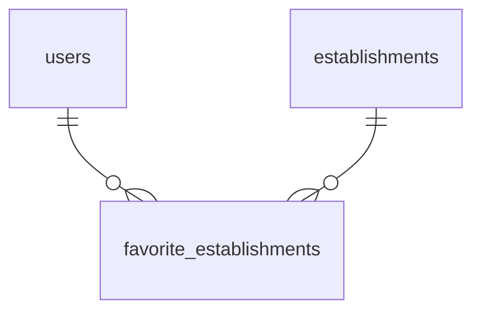
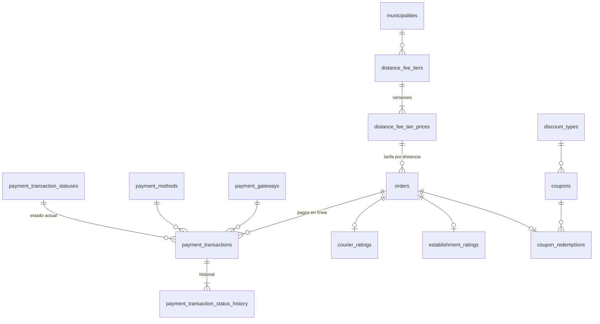
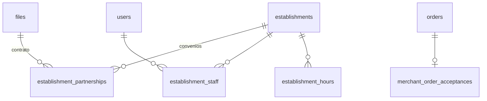

# E13 a E15 · Fases futuras

Estas épicas son de prioridad baja. Se documentan ahora para comprobar que el modelo del MVP las soporta **agregando tablas, sin rediseñar** las existentes. Los detalles se ajustan cuando se tome cada historia.

## E13 · Publicación y tiempo real

| Historia | Tablas |
| --- | --- |
| H13.1 Publicar en tiendas | Ninguna |
| H13.2 Tiempo real (Socket.IO + Redis) | Ninguna. Los eventos salen de las inserciones en los historiales; Redis guarda solo lo efímero (última ubicación, salas de socket) |
| H13.3 Repetir pedido y favoritos | `favorite_establishments (user_id, establishment_id, created_at)` con PK compuesta. "Repetir" no crea tablas: arma un carrito con la versión **vigente** de los productos de un pedido anterior (el precio pudo cambiar) |
| H13.4 Métricas | Vistas o vistas materializadas sobre `order_status_history`, `v_order_preparation`, `order_item_adjustments` e `incidents`. No se guardan métricas a mano |

## E14 · Pagos en línea y crecimiento

### H14.1 Pago en línea (RF-90)

| Tabla | Regla |
| --- | --- |
| `payment_gateways` (sistema) | `WOMPI`, `MERCADO_PAGO` |
| `payment_gateway_methods` | `payment_gateway_id`, `payment_method_id`, PK compuesta: qué medios cobra cada pasarela (por ejemplo `NEQUI` en línea por Wompi) |
| `payment_transactions` | `order_id`, `payment_gateway_id`, `payment_method_id` (`PSE`, `CARD`, `NEQUI`), `amount`, `external_reference` (`UNIQUE` por pasarela), `status_id`, `created_at` |
| `payment_transaction_statuses` | `CREATED`, `PENDING`, `APPROVED`, `DECLINED`, `REFUNDED` con transiciones e historial estándar. Los webhooks de la pasarela insertan en el historial |

Un pedido pagado en línea no tiene `COLLECTION` en la caja: el cliente le pagó a RapiChonta. En ese caso RapiChonta le debe al domiciliario la compra y su parte de la tarifa, así que la caja necesitará un tipo `ONLINE_SETTLEMENT` (−1) y la vista de cierre asignará el pedido a la caja por su asignación en lugar de por el cobro. Es un cambio de datos (tipo nuevo) y de vista, no de tablas.

### H14.2 Calificaciones (RF-91)

Dos tablas en lugar de una polimórfica, para que cada calificación tenga su llave foránea real:

- `courier_ratings (order_id PK, score smallint CHECK 1..5, comment, created_at)`.
- `establishment_ratings (order_id PK, score smallint CHECK 1..5, comment, created_at)`.

Quién calificó no se guarda: es el cliente del pedido. A quién se calificó tampoco: es el domiciliario del pedido (`v_order_courier`, su última asignación) o el establecimiento del pedido. Solo se permite en pedidos `counts_as_delivered` (disparador).

### H14.3 Cupones (RF-92)

| Tabla | Regla |
| --- | --- |
| `discount_types` (sistema) | `PERCENTAGE`, `FIXED_AMOUNT`, `FREE_DELIVERY` |
| `coupons` | `code citext UNIQUE`, `discount_type_id`, `value numeric(12,2)` (nulo en `FREE_DELIVERY`), `municipality_id`, `starts_at`, `ends_at`, `max_redemptions`, `max_per_customer`, `min_items_total`, `created_by_user_id`, `deactivated_at` |
| `coupon_redemptions` | `order_id` PK, `coupon_id`. El descuento se calcula en `v_order_amounts`; no se guarda |

"Vencido" se calcula con `ends_at`; "agotado" con el conteo de redenciones. Ninguno es un estado guardado.

### H14.4 Tarifa por distancia (RF-93)

`distance_fee_tiers (id, municipality_id, from_meters, to_meters, deactivated_at)` con `distance_fee_tier_prices (id, tier_id, amount, created_by_user_id, created_at)` versionadas, igual que las zonas.

El pedido pasa a apuntar a **una de dos** tarifas: se agrega `orders.distance_fee_price_id` nulo, `delivery_zone_fee_id` pasa a nulo y un `CHECK (num_nonnulls(delivery_zone_fee_id, distance_fee_price_id) = 1)` exige exactamente una. `v_order_amounts` toma el monto de la que exista. Cuál esquema usa cada municipio es un catálogo `fee_schemes` (`ZONE_FLAT`, `DISTANCE`) con su elección versionada en `municipality_fee_schemes (id, municipality_id, fee_scheme_id, effective_on, created_by_user_id)`; no es un parámetro porque `setting_values` solo guarda números.

## E15 · Comercios aliados

| Historia | Tablas |
| --- | --- |
| H15.1 Portal del comercio | Rol nuevo `MERCHANT` en `roles` con sus permisos. `establishment_staff (id, user_id, establishment_id, granted_by_user_id, granted_at, revoked_at)` dice a qué local pertenece cada usuario del comercio. `establishment_partnerships (id, establishment_id, started_on, ended_on, agreement_file_id)` reemplaza al antiguo `is_partner`: es aliado si tiene un convenio vigente. `establishment_hours (establishment_id, weekday, opens_at, closes_at)` para el horario propio del local |
| H15.2 Pedido directo o compra por RapiChonta | Se activa `MERCHANT_DIRECT` en `fulfillment_modes` (quitar `deactivated_at`). `merchant_order_acceptances (order_id PK, accepted_by_user_id, accepted_at, ready_at)`; y estados nuevos del pedido (`AWAITING_MERCHANT`, `READY_FOR_PICKUP`) con sus transiciones: se agregan como datos en los catálogos de [E04](E04-pedido-del-cliente.md#máquina-de-estados-del-pedido) |
| H15.3 Asignación automática | `order_offers.sent_by_user_id` nulo indica que la envió el sistema; la estrategia es un catálogo `assignment_strategies` referenciado desde la oferta. La carga se calcula con asignaciones vigentes y la calificación con `courier_ratings` |
| H15.4 Otros municipios | Sin tablas nuevas: un municipio con `launched_at`, sus zonas, tarifas, horario, comisión, parámetros y roles con alcance a ese municipio |
