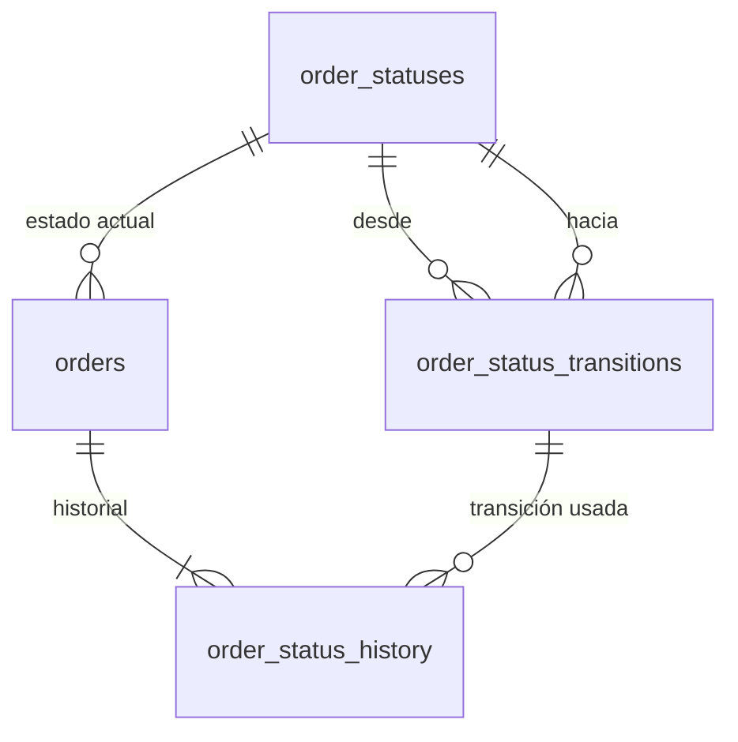
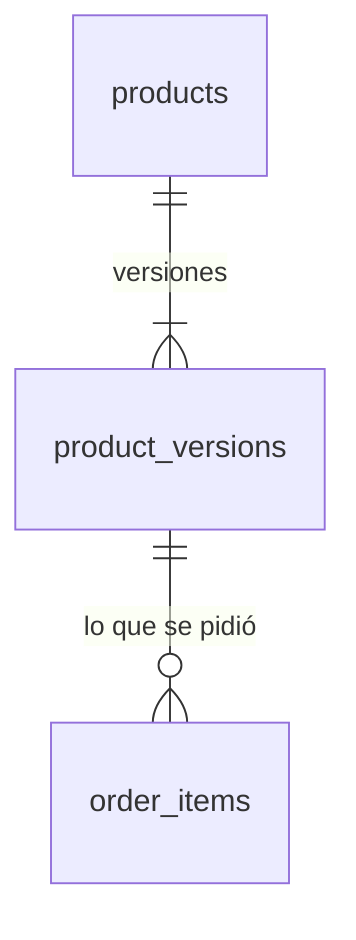
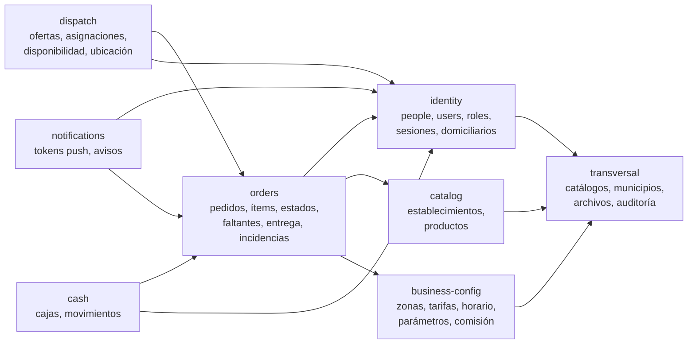
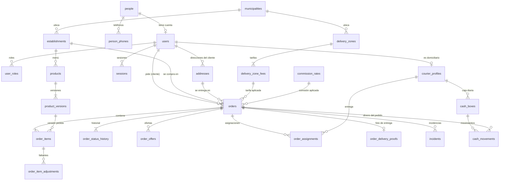

# 14 · Base de datos normalizada

Este es el diseño **objetivo** de la base de datos de RapiChonta: el que se implementa a partir de la épica E01 y sobre el que se construye todo lo demás. Reemplaza al esquema provisional descrito en [04 · Modelo de datos](../04-modelo-de-datos.md) (que sigue siendo el que está en `api/prisma/schema.prisma` hasta que la primera historia de E01 lo migre).

Está escrito para que un agente o desarrollador que toma una historia sepa exactamente qué tablas crear o usar, cómo se relacionan y qué reglas debe garantizar la base de datos.

## Cómo leer esta carpeta

| Documento | Contenido | Épicas |
| --- | --- | --- |
| [README](README.md) (este) | Principios, convenciones, patrones, mapa de módulos y plan de migración | Todas |
| [00 · Transversal](00-transversal.md) | Catálogos del sistema, geografía (municipios), idiomas, monedas, archivos y auditoría | Todas |
| [E01 · Identidad y acceso](E01-identidad-y-acceso.md) | `people`, `users`, roles, permisos, OTP, sesiones, consentimientos, domiciliarios | E01, E08.7 |
| [E02 · Establecimientos y menús](E02-establecimientos-y-menus.md) | Establecimientos, categorías, secciones del menú, productos versionados | E02 |
| [E03 · Zonas, horario y configuración](E03-zonas-horario-configuracion.md) | Zonas y tarifas versionadas, horario, parámetros, comisión, tasas de cambio | E03, E12.1 |
| [E04 · Pedido del cliente](E04-pedido-del-cliente.md) | Direcciones, destinatarios, pedidos, ítems, máquina de estados del pedido | E04, E09.1 |
| [E06 · Notificaciones](E06-notificaciones.md) | Tokens push, notificaciones y entregas | E06 |
| [E07 · Asignación](E07-asignacion.md) | Ofertas, destinatarios de la oferta y asignaciones | E07 |
| [E08 · Modo domiciliario](E08-modo-domiciliario.md) | Disponibilidad, ubicaciones, geocercas, compra y preparación, trabajo sin señal | E08 |
| [E09 · Producto faltante](E09-producto-faltante.md) | Reportes de producto faltante o con otro precio y la decisión del cliente | E09 |
| [E10 · Entrega e incidencias](E10-entrega-e-incidencias.md) | Confirmación de entrega, foto, cancelaciones e incidencias | E10 |
| [E11 · Cajas y comisiones](E11-cajas-y-comisiones.md) | Caja diaria, libro de movimientos, cierre y liquidación | E11, E10.2 |
| [E13–E15 · Fases futuras](E13-E15-fases-futuras.md) | Favoritos, métricas, pagos en línea, calificaciones, cupones, tarifa por distancia, comercios aliados | E13, E14, E15 |

E05 (calidad y entrega continua) y E12 (piloto) no crean tablas: E12 solo carga datos en las tablas de E02 y E03.

## Principios

1. **Una responsabilidad por tabla.** Cada tabla describe una sola cosa. Los datos de la persona viven en `people`; el acceso (credenciales, estado de la cuenta, roles, sesiones) vive en `users` y sus tablas hijas. Un domiciliario es un `user` con perfil `courier_profiles`; su vehículo, sus documentos y sus cuentas de cobro son tablas aparte.
2. **Cada dato se guarda una sola vez (3FN/FNBC).** Nada que se pueda calcular a partir de otras columnas se guarda: totales, comisiones, "cliente nuevo", "caja abierta", "domiciliario disponible", "pedido retrasado" y la hora estimada de listo se calculan en vistas. Las excepciones son las cuatro de la sección [Excepciones deliberadas](#excepciones-deliberadas), cada una justificada y protegida por la base de datos.
3. **Nada de `enum` ni estados quemados en el código.** Cada tipo de estado o de clasificación es una **tabla catálogo** propia (`user_statuses`, `order_statuses`, `establishment_statuses`, ...). Agregar un estado, cambiar su orden o su texto es insertar o editar una fila, no migrar ni desplegar.
4. **Los hechos no se editan, se agregan.** Los cambios de estado, los precios, las tarifas, la comisión, los parámetros y el dinero se guardan como filas nuevas (historial o versión). Lo vigente es la última fila. Así un pedido viejo siempre apunta a la tarifa, al precio y a la comisión con que se creó, **sin copiar** esos valores en el pedido.
5. **La integridad la garantiza la base de datos, no solo el código.** Llaves foráneas en todas las relaciones, llaves foráneas compuestas para que un pedido solo use direcciones de su cliente, `CHECK` para rangos y reglas por tipo, índices únicos parciales para "solo uno vigente" y disparadores para lo inmutable.
6. **Preparado para varios municipios.** Todo lo que depende del lugar (establecimientos, zonas, horario, comisión, parámetros, alcance de los roles) cuelga de `municipalities`. Villagarzón es la primera fila, no un supuesto en el código.

## Convenciones

| Tema | Regla |
| --- | --- |
| Nombres | Tablas y columnas en inglés, `snake_case`, tablas en plural (`order_items`). Llave foránea: `<entidad>_id`; si hay varias a la misma tabla, con rol: `created_by_user_id`, `courier_user_id`. |
| Llave primaria de entidades | `id uuid DEFAULT gen_random_uuid()`. |
| Llave primaria de catálogos | `id smallint GENERATED ALWAYS AS IDENTITY` más `code varchar(40) UNIQUE NOT NULL` en `SCREAMING_SNAKE_CASE`. El código del programa usa siempre el `code`, nunca el `id`. |
| Tablas 1:1 | La llave primaria es la misma llave foránea (`courier_profiles.user_id`, `order_purchases.order_id`). |
| Tablas puente N:M | Llave primaria compuesta (`role_permissions (role_id, permission_id)`), salvo que la relación tenga vida propia (altas y bajas con fecha), en cuyo caso lleva `id`. |
| Fechas y horas | Siempre `timestamptz` (se guarda en UTC). Fechas de negocio (`business_date`) en `date` interpretadas con la zona horaria del municipio. Horas del día en `time`. |
| Eventos | Un evento se guarda como fecha, no como booleano: `verified_at`, `revoked_at`, `archived_at`, `deactivated_at`. `NULL` significa "no ha ocurrido". |
| Booleanos | Solo para propiedades fijas de un catálogo (`order_statuses.is_terminal`) o una marca de "principal" (`is_primary`, `is_default`) con índice único parcial. Nunca para estados. |
| Dinero | `numeric(12,2)` en pesos colombianos (RNF-05). Porcentajes `numeric(5,4)` (0.1500 = 15 %). Montos siempre positivos; el sentido lo da el tipo de movimiento. |
| Geografía | `geography(Point, 4326)` y `geography(Polygon, 4326)` con índice GIST. Prisma las declara como `Unsupported` y se consultan con SQL parametrizado. |
| Teléfonos | `varchar(16)` en formato E.164 con `CHECK (phone_e164 ~ '^\+[1-9][0-9]{6,14}$')`. |
| Correos | `citext` (comparación sin mayúsculas). |
| Borrado | `ON DELETE RESTRICT` por defecto. `CASCADE` solo en hijos sin significado propio (traducciones, puentes de permisos). Nada financiero ni histórico se borra; se archiva con fecha o se anonimiza. |
| Orden de versiones | Las tablas de versiones e historiales usan `DEFAULT clock_timestamp()` (no `now()`, que es la misma hora en toda la transacción) para que dos versiones creadas en la misma transacción no choquen ni empaten. |
| Índices únicos con columnas nulas | Se crean con `NULLS NOT DISTINCT` (PostgreSQL 15+) cuando el nulo significa "global" o "ninguno" y no "desconocido". |
| Auditoría | Las tablas que crea o cambia el personal llevan `created_by_user_id` y `created_at`. Las acciones sensibles se registran además en `audit_logs` ([00](00-transversal.md#auditoría)). |
| Textos visibles | Los catálogos del sistema no guardan textos: la web y la app traducen por `code` en sus archivos JSON/ARB (RNF-03). Los catálogos que crea el administrador (categorías de establecimiento, secciones del menú) guardan su nombre en una tabla `*_translations` por idioma. |

## Patrones

### Catálogo de estados + historial + estado actual

Todo lo que tiene **tres o más estados** tiene su **catálogo de estados propio** y una llave foránea `status_id` en la entidad: nunca un `enum` ni un texto. Lo que solo puede estar activo o dado de baja usa una fecha (`deactivated_at`), no un catálogo.

Hay dos niveles, según cuánto importa la trazabilidad:

| Nivel | Qué lleva | Entidades |
| --- | --- | --- |
| **Completo** | Catálogo + tabla de transiciones + historial inmutable + disparador | `orders`, `incidents`, `users` (cuenta), `courier_profiles` (verificación), `payment_transactions` (E14) |
| **Simple** | Catálogo + `status_id`; la transición la valida el dominio y el cambio queda en `audit_logs` | `establishments`, `products` (disponibilidad), `courier_documents`, `data_requests` |

Pasar una entidad de simple a completo después es agregar dos tablas, sin tocar las existentes. El nivel completo funciona así:

- **`<entidad>_statuses`**: catálogo (`id`, `code`, `sort_order`, `is_initial`, `is_terminal` y las marcas de comportamiento que necesite cada entidad).
- **`<entidad>_status_transitions`** (cuando hay reglas): pares permitidos `from_status_id → to_status_id`. Es la máquina de estados en datos.
- **`<entidad>_status_history`**: una fila inmutable por cambio (`from_status_id`, `to_status_id`, quién, por qué medio, cuándo). La llave foránea compuesta `(from_status_id, to_status_id)` hacia las transiciones impide registrar un cambio no permitido. La primera fila de cada entidad tiene `from_status_id` nulo y su `to_status_id` debe ser un estado con `is_initial` (lo verifica el disparador, porque una llave foránea compuesta no se evalúa cuando una de sus columnas es nula).
- **`<entidad>.status_id`**: el estado actual. **No lo escribe el código**: lo actualiza el disparador `AFTER INSERT` del historial. Por eso no puede quedar distinto del historial y, de paso, resuelve la concurrencia (dos domiciliarios aceptando a la vez: solo uno pasa).

El disparador del historial hace, para cada fila nueva:

1. **Primera fila** (`from_status_id` nulo): no actualiza nada; comprueba que `to_status_id` sea un estado `is_initial` y que coincida con el `status_id` con que se insertó la entidad.
2. **Cambio** (`from` lleno): `UPDATE <entidad> SET status_id = :to WHERE id = :id AND status_id = :from` y error si no afectó una fila (otro cambio llegó primero).

Para que nadie más escriba `status_id`, un disparador `BEFORE UPDATE OF status_id` en la entidad rechaza el cambio salvo cuando viene del disparador del historial (`pg_trigger_depth() > 1`).

Al **crear** la entidad, `status_id` se inserta con el estado `is_initial` y, en la misma transacción, la primera fila del historial. Un `CREATE CONSTRAINT TRIGGER ... DEFERRABLE INITIALLY DEFERRED` sobre la entidad comprueba al confirmar la transacción que esa primera fila existe. Después, el código cambia un estado de una sola forma: insertando en el historial dentro de la transacción del caso de uso.

Las tres funciones (`fn_status_history_apply`, `fn_status_column_guard`, `fn_status_history_required`) se escriben **una vez**, genéricas, y reciben el nombre de la tabla como argumento del disparador.

### Versiones inmutables (precio, tarifa, comisión, parámetros)

La entidad estable (`products`, `delivery_zones`) guarda la identidad; cada cambio de lo que puede variar (nombre, precio, tiempo de preparación, tarifa) es una fila nueva en `*_versions` / `*_fees` / `*_rates`. Lo vigente es la última fila por `created_at` y se lee con una vista `v_current_*`. Los pedidos apuntan a la versión exacta, así que **no copian** nombre ni precio.

### Libro de movimientos

El dinero se registra en un libro (`cash_movements`) de filas inmutables con monto positivo y un tipo que define el sentido (+1 / −1). Los errores se corrigen con un movimiento inverso que apunta al original. Los saldos son vistas ([E11](E11-cajas-y-comisiones.md)).

## Mapa de módulos

Cada módulo de la API (arquitectura limpia, [03](../03-arquitectura.md)) es dueño de sus tablas. Otro módulo puede leerlas por llave foránea pero solo las modifica el dueño.

## Diagrama general (solo entidades principales)

## Excepciones deliberadas

La normalización total tiene estas excepciones conscientes, y ninguna más. Cada una está protegida para que no pueda quedar inconsistente.

| Dato | Por qué se guarda | Cómo se protege |
| --- | --- | --- |
| `status_id` en cada entidad con historial | Filtrar "pedidos activos" o "domiciliarios verificados" sin recorrer el historial, y resolver la concurrencia con un `UPDATE` condicional. | Solo lo escribe el disparador del historial; un `UPDATE` directo de la columna se rechaza. |
| `from_status_id` en cada historial | Validar la transición con una llave foránea a la tabla de transiciones. | Lo valida el mismo disparador contra el estado actual. |
| `expires_at` en ofertas, OTP, tokens de refresco y reportes de faltante | Es el plazo que se le comunicó a la persona, aunque el parámetro cambie después. | Se calcula una sola vez al crear la fila; la fila es inmutable. |
| `orders.created_at` (igual a la primera fila del historial) | Ordenar y paginar "Mis pedidos" y el panel con un índice sin unir el historial. | La escriben el mismo `INSERT` y la primera fila del historial; nunca se actualiza. |
| `order_assignments.order_id` y `order_item_adjustments.order_id` (derivables de la oferta y de la consulta) | Índice único parcial "una asignación vigente por pedido" (que no puede mirar otra tabla) y FK compuestas que garantizan que la línea consultada es del mismo pedido. | FK compuestas hacia `(id, order_id)` del padre: no pueden diferir de él. |
| `audit_logs.entity_table` + `entity_id` (referencia polimórfica) | Un único registro de auditoría para cualquier tabla (RNF-07). | Solo inserción; nunca se usa para lógica de negocio. |

## Integridad que no cabe en una llave foránea

Se implementan en SQL dentro de las migraciones de Prisma (Prisma no genera `CHECK`, índices parciales, exclusiones ni disparadores):

- Índices únicos parciales para "solo uno vigente" (teléfono principal, dirección por defecto, una asignación activa por pedido, un periodo de disponibilidad abierto por domiciliario).
- Disparadores de estado actual (patrón de arriba) y de inmutabilidad (`BEFORE UPDATE OR DELETE ... RAISE EXCEPTION`) en historiales, versiones y movimientos.
- Disparador que verifica que cada `order_items.product_version_id` pertenece al establecimiento del pedido.
- Vistas `v_current_*` para lo vigente y vistas de cálculo (`v_order_amounts`, `v_cash_box_balances`, ...). Prisma las lee con la vista previa `views` o con `$queryRaw`.

## Concurrencia

PostgreSQL trabaja en `READ COMMITTED`: dos transacciones pueden pasar a la vez un disparador que "cuenta" o "busca" filas. Por eso toda regla de unicidad que no es un índice nativo **bloquea primero la fila padre**:

| Regla | Se bloquea |
| --- | --- |
| Zonas que no se superponen | `SELECT ... FROM municipalities WHERE id = :m FOR UPDATE` |
| Franjas de horario que no se superponen | `EXCLUDE USING gist (municipality_id WITH =, weekday WITH =, timerange(opens_at, closes_at) WITH &&) WHERE (deactivated_at IS NULL)` con `btree_gist` y el tipo `timerange` (`CREATE TYPE timerange AS RANGE (subtype = time)`) |
| Una incidencia sin resolver por pedido, máximo de destinatarios de una oferta | La fila de `orders` `FOR UPDATE` |
| Movimientos solo en caja abierta | El movimiento toma la caja `FOR SHARE`; el cierre la toma `FOR UPDATE` |

Lo que sí se puede expresar como índice único parcial (una asignación vigente, un periodo de disponibilidad abierto, un faltante pendiente por línea) se deja al índice, que es atómico.

## Prisma

- **Columnas `geography` obligatorias:** un modelo con un campo `Unsupported(...)` obligatorio no tiene `create` ni `update` en Prisma Client. Las tablas con puntos o polígonos (`establishments`, `addresses`, `delivery_zones`, `municipalities`, `courier_location_pings`) se escriben en su repositorio de infraestructura con `$executeRaw` y `Prisma.sql` (parametrizado) y se leen con Prisma normal o `$queryRaw`.
- **Lo que Prisma no conoce** (`CHECK`, índices parciales, `NULLS NOT DISTINCT`, exclusiones, disparadores, vistas) se escribe en SQL al final del `migration.sql` generado. Prisma Migrate puede proponer borrar esos índices en la migración siguiente: **toda migración nueva se revisa antes de aplicarla** y se quita cualquier `DROP INDEX` o `DROP TRIGGER` que no sea intencional. Los índices parciales se declaran también en `schema.prisma` cuando la versión de Prisma lo permita.
- **Vistas:** con la vista previa `views` de Prisma o con `$queryRaw` tipado.

## Plan de migración desde el esquema actual

No hay datos reales todavía (solo el entorno de pruebas en Neon), así que no se escribe una migración de datos:

1. La **primera historia de E01** (H01.1) reemplaza la migración `20261015000000_init` por una nueva migración inicial con [00 · Transversal](00-transversal.md), [E01](E01-identidad-y-acceso.md), [E02](E02-establecimientos-y-menus.md) y [E03](E03-zonas-horario-configuracion.md), porque el endpoint `GET /api/v1/establishments/nearby` ya existe y depende de establecimientos. Se eliminan los `enum` del esquema actual y se carga la semilla de catálogos.
2. Cada épica siguiente agrega sus tablas en la migración de su primera historia (E04 pedidos, E07 asignación, etc.).
3. La consulta de cercanos cambia `WHERE is_active` por el estado `ACTIVE` del catálogo (vista `v_map_establishments`).
4. Al terminar la migración de E01, [04 · Modelo de datos](../04-modelo-de-datos.md) se reduce a un resumen que apunta a esta carpeta.

## Semilla de catálogos

Los catálogos del sistema (estados, roles, permisos, medios de pago, ...) se cargan con `prisma/seed.ts` de forma **idempotente** (`INSERT ... ON CONFLICT (code) DO UPDATE`). Cada documento de épica lista los códigos iniciales de sus catálogos. Al arrancar, la API carga los catálogos en memoria y falla si falta un `code` que el código del programa necesita.

### ¿Entonces el código nunca nombra un estado?

Lo nombra **por su `code`** cuando ese estado tiene comportamiento (por ejemplo, al entrar a `ACCEPTED` empieza la detección de llegada al local). Lo que **no** hace el código es definir la lista de estados, su orden, sus textos, cuáles son terminales o qué transiciones están permitidas: eso vive en los catálogos y en `order_status_transitions`. Un estado nuevo sin comportamiento propio (por ejemplo `AWAITING_PICKUP`) se agrega solo con datos.
